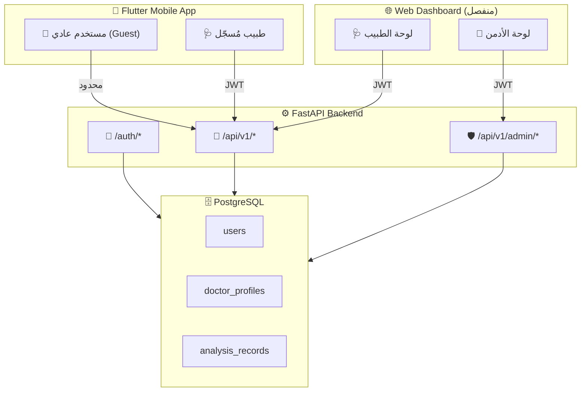
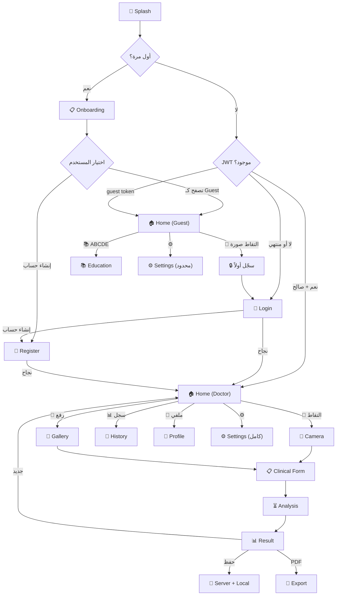
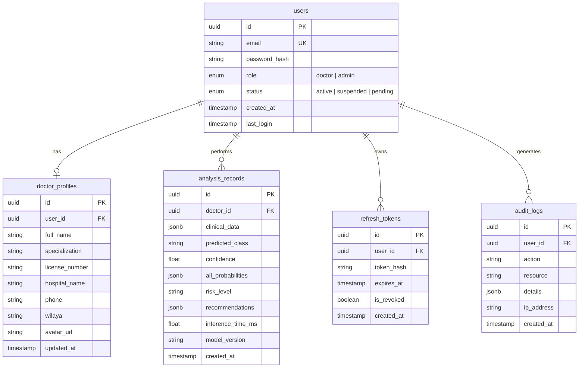

# 🏗️ نقاش معمارية MedAssist AI — كل الصفحات والتغييرات

## المعمارية العامة المقترحة



---

## 📌 الأدوار الثلاثة — ماذا يرى كل واحد؟

| القدرة | 👤 Guest (بدون حساب) | 🩺 Doctor (مُسجّل) | 👑 Admin |
|--------|---------------------|-------------------|---------|
| **مكان الوصول** | 📱 Mobile فقط | 📱 Mobile + 🌐 Web | 🌐 Web فقط |
| عرض Onboarding | ✅ | ✅ (أول مرة) | — |
| صفحة Education (ABCDE) | ✅ | ✅ | — |
| صفحة About | ✅ | ✅ | — |
| التقاط/رفع صورة | ❌ → يظهر prompt تسجيل | ✅ | — |
| تعبئة Clinical Form | ❌ | ✅ | — |
| تحليل AI | ❌ | ✅ | — |
| عرض النتائج | ❌ | ✅ | — |
| تصدير PDF | ❌ | ✅ | — |
| سجل التحليلات | ❌ | ✅ (Local + Server) | ✅ (كل التحليلات) |
| الملف الشخصي | ❌ | ✅ | ✅ |
| إحصائيات شخصية | ❌ | ✅ (Web Dashboard) | — |
| إدارة المستخدمين | ❌ | ❌ | ✅ |
| إحصائيات النظام | ❌ | ❌ | ✅ |
| الإعدادات | ✅ (لغة فقط) | ✅ (كامل) | ✅ (Web) |

---

## 📱 تطبيق الهاتف (Flutter) — كل صفحة بالتفصيل

---

### 🆕 صفحات جديدة يجب إضافتها

---

#### 1. 🔐 Login Page `/login`

**المحتوى المقترح:**
- شعار التطبيق + اسمه في الأعلى
- حقل Email مع validation
- حقل Password مع toggle visibility
- زر "تسجيل الدخول" (primary)
- رابط "نسيت كلمة المرور؟"
- فاصل "أو"
- زر "إنشاء حساب جديد" (outlined)
- رابط "متابعة كـ Guest" (نص صغير أسفل الصفحة)

**📝 نقاط نقاشية:**
> [!IMPORTANT]
> **سؤال 1**: هل تريد "متابعة كـ Guest" أم تُجبر الجميع على التسجيل؟
> - إذا أجبرت الجميع → أبسط في الكود لكن أقل مستخدمين
> - إذا سمحت بـ Guest → يحتاج Guard على كل route محمي

> [!NOTE]
> **سؤال 2**: هل تحتاج Social Login (Google Sign-In) أم Email/Password فقط؟
> - Email/Password كافي لمشروع ماستر ويُبقي JWT مخصصاً 100%
> - Google Sign-In يضيف تعقيداً + اعتماد على Google

---

#### 2. 📝 Register Page `/register`

**المحتوى المقترح:**
- Header: "إنشاء حساب طبيب"
- **Step 1 — بيانات الحساب:**
  - الاسم الكامل
  - البريد الإلكتروني (مع validation)
  - كلمة المرور (مع مؤشر قوة)
  - تأكيد كلمة المرور
- **Step 2 — بيانات مهنية:**
  - التخصص (Dropdown: طب عام، أمراض جلدية، جراحة، أخرى)
  - رقم الترخيص الطبي (اختياري أم إلزامي؟)
  - اسم المستشفى/العيادة
  - الولاية (48 ولاية جزائرية - Dropdown)
  - رقم الهاتف
- زر "إنشاء الحساب"
- رابط "لديك حساب؟ سجّل الدخول"

**📝 نقاط نقاشية:**

> [!IMPORTANT]
> **سؤال 3**: هل التسجيل مفتوح فوراً أم يحتاج موافقة Admin؟
> - **مفتوح فوراً**: أسهل — الطبيب يُسجّل ويدخل مباشرة
> - **يحتاج موافقة**: أأمن — Admin يتحقق من الترخيص الطبي أولاً
> - **حل وسط**: التسجيل مفتوح + حالة `pending_verification` يراها Admin → الطبيب يستخدم التطبيق لكن بعلامة "غير موثّق"

> [!NOTE]
> **سؤال 4**: هل تحتاج تأكيد Email (verification link)؟
> - يحتاج SMTP service (إرسال إيميلات)
> - يمكن تأجيله وجعله optional في V1

> **سؤال 5**: هل Step 1 + Step 2 في صفحة واحدة (scroll) أم Stepper (خطوات)؟
> - Stepper أجمل وأقل إرهاقاً بصرياً
> - صفحة واحدة أسرع في التطوير

---

#### 3. 🔑 Forgot Password Page `/forgot-password`

**المحتوى:**
- حقل Email
- زر "إرسال رابط إعادة التعيين"
- رسالة نجاح: "تحقق من بريدك الإلكتروني"
- رابط العودة لتسجيل الدخول

> [!WARNING]
> **ملاحظة**: هذا يحتاج خدمة إرسال إيميلات (SMTP). إذا لم تكن متاحة، يمكنك:
> - تأجيل هذه الصفحة بالكامل
> - أو جعل Admin يُعيد تعيين كلمة المرور يدوياً من Dashboard

---

#### 4. 👤 Doctor Profile Page `/profile`

**المحتوى المقترح:**
- صورة رمزية (Avatar) مع إمكانية التغيير (أو الأحرف الأولى فقط)
- معلومات شخصية (قابلة للتعديل):
  - الاسم الكامل
  - التخصص
  - المستشفى/العيادة
  - الولاية
  - رقم الهاتف
- معلومات الحساب (غير قابلة للتعديل مباشرة):
  - البريد الإلكتروني
  - تاريخ الانضمام
  - حالة التوثيق (موثّق ✅ / قيد المراجعة ⏳)
- زر "تغيير كلمة المرور"
- زر "حفظ التعديلات"
- إحصائية سريعة: عدد التحليلات الإجمالي

**📝 نقاط نقاشية:**

> **سؤال 6**: هل Profile في الـ Mobile فقط أم في الـ Web Dashboard أيضاً؟
> - الأفضل: في كليهما، مع تعديل كامل في Web ومحدود في Mobile

---

#### 5. ℹ️ About Page `/about`

**الملاحظة:** Route موجود فعلاً في `app_routes.dart` لكن غير مُسجّل في `app_pages.dart` ولا توجد له View.

**المحتوى المقترح:**
- شعار التطبيق + اسمه + الإصدار
- وصف مختصر: "منصة دعم التشخيص الطبي بالذكاء الاصطناعي"
- معلومات النموذج: EfficientNet-B3 V6.0، دقة 74.31%
- الفئات المدعومة (6 فئات)
- إخلاء المسؤولية الطبية (كامل)
- فريق التطوير (أسماءكم)
- الجامعة والمشرفة
- رابط التواصل / الدعم
- "مشروع مذكرة ماستر 2025/2026"

---

### 📝 صفحات موجودة — التغييرات المطلوبة

---

#### 6. 🌊 Splash Page `/splash` — تعديل

**الحالة الحالية:** يتحقق من `firstTime` فقط → يذهب لـ Onboarding أو Home.

**التغيير المطلوب:**
```
Splash يبدأ
├── هل أول مرة؟ → ONBOARDING
├── هل يوجد JWT token مخزّن؟
│   ├── نعم → تحقق من صلاحيته (refresh إذا انتهى)
│   │   ├── صالح → HOME (كطبيب)
│   │   └── منتهي + refresh فشل → LOGIN
│   └── لا → HOME (كـ Guest)
└── أو مباشرة → LOGIN (إذا قررت إجبار التسجيل)
```

> **سؤال 7**: بعد Onboarding، هل يذهب لـ LOGIN أم HOME كـ Guest؟
> - إذا Login: كل مستخدم يجب أن يُسجّل
> - إذا HOME كـ Guest: يتصفح ويُشجَّع على التسجيل

---

#### 7. 📋 Onboarding Page `/onboarding` — تعديل طفيف

**الحالة الحالية:** 3-4 slides مع أيقونات فقط (بدون صور).

**التغيير المقترح:**
- إضافة slide أخير: "سجّل كطبيب للوصول الكامل" مع زر "إنشاء حساب"
- تغيير زر "Get Started" الأخير:
  - إذا سمحت بـ Guest: زرين → "إنشاء حساب" (primary) + "تصفح كـ Guest" (text)
  - إذا أجبرت التسجيل: زر واحد → "إنشاء حساب"

---

#### 8. 🏠 Home Page `/home` — تعديل كبير

**الحالة الحالية:** يعرض مباشرة: Take Photo, Upload Photo, History, Education, Settings.

**التغيير المطلوب — حسب الدور:**

**👤 Guest يرى:**
- Hero section: اسم التطبيق + وصف
- بطاقة CTA كبيرة: "سجّل كطبيب لبدء التشخيص" → LOGIN/REGISTER
- بطاقات معلوماتية (غير تفاعلية أو بأيقونة قفل):
  - "📸 التقاط صورة" → 🔒 يظهر BottomSheet "سجّل للاستخدام"
  - "📁 رفع صورة" → 🔒 نفس الشيء
- بطاقات مفتوحة:
  - "📚 تعلّم ABCDE" → EDUCATION ✅
  - "⚙️ الإعدادات" → SETTINGS ✅
- Disclaimer في الأسفل

**🩺 Doctor يرى:**
- Hero section: "مرحباً، د. [الاسم]" + آخر نشاط
- بطاقتا الإجراء الرئيسيتان (كما هي):
  - "📸 التقاط صورة" → CAMERA ✅
  - "📁 رفع صورة" → Gallery → CLINICAL_FORM ✅
- بطاقات سريعة:
  - "📊 سجل التحليلات" → HISTORY
  - "📚 تعلّم ABCDE" → EDUCATION
  - "👤 ملفي الشخصي" → PROFILE (جديد)
  - "⚙️ الإعدادات" → SETTINGS
- إحصائية سريعة في الأعلى: "أجريت X تحليل هذا الشهر"

> [!IMPORTANT]
> **سؤال 8**: هل تريد BottomNavigationBar بدل الشكل الحالي؟
> - الحالي: كل شيء في صفحة Home كبطاقات → شكل Landing page
> - بديل: BottomNavBar مع tabs (Home, History, Profile, Settings) → شكل تطبيق كلاسيكي
> - **الشكل الحالي أبسط وأسرع تطويراً** لكن BottomNav أكثر احترافية

---

#### 9. 📸 Camera Page `/camera` — بدون تغيير كبير

**الحالة الحالية:** كاميرا كاملة مع overlay + guide circle + flash toggle + quality indicator.

**التغيير الوحيد:**
- إضافة Guard: إذا Guest → redirect to LOGIN (لا يصل لهذه الصفحة أصلاً)
- الباقي ممتاز كما هو

---

#### 10. 📋 Clinical Form `/clinical-form` — تعديلات

**الحالة الحالية:** 7 حقول (age, sex, location, diameter, growth, bleeding, history).

**التغييرات المطلوبة:**

| التغيير | التفاصيل | الأولوية |
|---------|----------|---------|
| إضافة حقل `elevation` (البروز) | Backend يدعمه (V6.0) لكنه غير موجود في Form | 🔴 عالية |
| Form Validation حقيقي | استخدام `TextFormField` + `validator` + `GlobalKey<FormState>` | 🔴 عالية |
| حد أدنى للعمر | لا يسمح بـ 0 — الحد الأدنى 1 سنة | 🟡 متوسطة |
| تأكيد اختيار الجنس | لا يسمح بالإرسال دون اختيار | 🟡 متوسطة |
| Guard للـ Guest | لا يصل لهذه الصفحة بدون تسجيل | 🔴 عالية |

> **سؤال 9**: هل `elevation` (بروز الآفة) يكون Yes/No مثل growth و bleeding، أم slider رقمي؟
> - Backend يستقبله كـ boolean على ما يبدو → Yes/No selector

---

#### 11. ⏳ Analysis Page `/analysis` — تعديل طفيف

**الحالة الحالية:** شاشة انتظار مع progress + animations.

**التغييرات:**
- إرسال JWT token مع الطلب (`Authorization: Bearer <token>`)
- تحسين Error handling:
  - 401 → Session expired → redirect to LOGIN
  - 429 → Rate limited → رسالة "حاول بعد X ثانية"
  - 500 → Server error → رسالة واضحة مع retry
  - No connection → رسالة + زر retry

---

#### 12. 📊 Result Page `/result` — تعديلات مهمة

**الحالة الحالية:** يعرض diagnosis, confidence, risk level, probabilities, recommendations.

**التغييرات المطلوبة:**

| التغيير | التفاصيل |
|---------|----------|
| 🔴 **إصلاح CRITICAL bug** | `_getRiskLevelTranslation` لا يتعرف على `CRITICAL` — يرجع `HIGH` لكل شيء غير `LOW/MODERATE` |
| 🟡 حفظ على السيرفر | بدل حفظ محلي فقط → حفظ في PostgreSQL عبر API |
| 🟡 ربط بالطبيب | كل تحليل يُربط بـ `doctor_id` |

**الحل لـ bug CRITICAL:**
```dart
// الحالي (خاطئ):
if (level == 'LOW') return 'منخفض';
if (level == 'MODERATE') return 'متوسط';
return 'مرتفع'; // ← يرجع HIGH لكل شيء آخر بما فيه CRITICAL

// المطلوب:
if (level == 'LOW') return 'منخفض';
if (level == 'MODERATE') return 'متوسط';
if (level == 'HIGH') return 'مرتفع';
if (level == 'CRITICAL') return 'حرج';
return level; // fallback
```

---

#### 13. 📜 History Page `/history` — تعديل كبير

**الحالة الحالية:** يقرأ من GetStorage المحلي فقط.

**التغيير المطلوب:**
- مصدر البيانات: **Server أولاً** (API call) → fallback إلى Local cache
- Pagination (لا تحمّل كل السجلات مرة واحدة)
- فلترة: حسب التاريخ، نوع التشخيص، مستوى الخطر
- بحث: بكلمة مفتاحية
- Sync: عند الاتصال بالإنترنت → sync local مع server

> **سؤال 10**: هل تحتاج History في Mobile أم تكتفي بـ Web Dashboard؟
> - **الأفضل: في كليهما** — Mobile للوصول السريع، Web للتحليل المعمّق
> - إذا الوقت ضيق: Mobile يعرض آخر 10 فقط + "عرض الكل في Dashboard"

---

#### 14. ⚙️ Settings Page `/settings` — تعديلات

**الحالة الحالية:** API URL, Language, Clear Data.

**التغيير المقترح حسب الدور:**

**👤 Guest:**
- اللغة فقط (AR, EN, FR)
- زر "تسجيل الدخول"

**🩺 Doctor:**
- اللغة (AR, EN, FR)
- Dark Mode toggle (تفعيله أخيراً!)
- الإشعارات (مستقبلاً)
- إعدادات الخصوصية
- زر "تسجيل الخروج" (أحمر)
- رقم الإصدار + رابط About

**إزالة:**
- ~~حقل API URL~~ → هذا يجب أن يكون **config ثابت** في الكود أو environment variable، ليس في Settings
  
> [!WARNING]
> **ملاحظة مهمة**: حقل API URL الحالي يسمح لأي شخص بتوجيه الطلبات لخادم آخر — هذه **ثغرة أمنية**. يجب إزالته من Settings وتثبيته في الكود.

> **سؤال 11**: هل تريد إبقاء API URL في Settings (للتطوير/Demo فقط) أم إزالته نهائياً؟
> - حل وسط: يظهر فقط في Debug mode ويختفي في Release

---

#### 15. 📚 Education Page `/education` — تعديل طفيف

**الحالة الحالية:** ABCDE Rule فقط، نصوص hardcoded بالإنجليزية.

**التغييرات:**
- ترجمة كل النصوص (AR, FR, EN) عبر ملفات i18n
- إضافة صور توضيحية لكل حرف (Asymmetry, Border, etc.)
- (اختياري) إضافة محتوى تعليمي إضافي عن أنواع سرطان الجلد الستة

---

### 🔀 Flow المُعدَّل للتطبيق



---

---

## 🌐 Web Dashboard (تطبيق ويب منفصل) — كل الصفحات

---

### 🛠️ التقنية المقترحة للويب

| الخيار | المزايا | العيوب | التقييم |
|--------|---------|--------|---------|
| **React + Vite + TailwindCSS** | سريع، مرن، مجتمع ضخم، مكتبات Dashboard جاهزة | يحتاج تعلّم React | ⭐⭐⭐⭐ |
| **Next.js** | SSR, routing جاهز, full-stack | أثقل من اللازم لـ Dashboard بسيط | ⭐⭐⭐ |
| **Vue.js + Vuetify** | أسهل تعلّم من React، مكونات Material جاهزة | مجتمع أصغر | ⭐⭐⭐ |
| **Svelte** | أسرع وأخف | مكتبات أقل | ⭐⭐ |
| **Admin Template جاهز** | سرعة تطوير قصوى | أقل تخصيصاً | ⭐⭐⭐⭐⭐ |

> [!TIP]
> **توصيتي**: **React + Vite + TailwindCSS** مع مكتبة UI مثل **Shadcn/ui** أو **Ant Design** + مكتبة Charts مثل **Recharts**.
> - أو إذا أردت أسرع حل: استخدم **Admin Template جاهز** مثل [Tremor](https://tremor.so) (React Dashboard components) وعدّله.

> [!IMPORTANT]
> **سؤال 12**: ما مستوى خبرتك في Web Frontend (React/Vue/Angular)؟ هذا يحدد الخيار المناسب.
> إذا خبرتك صفر في React:
> - الحل الأسرع: **Template جاهز** يوفر أسابيع
> - أو تعلّم React أساسي (3-5 أيام) ثم ابدأ

---

### 🔐 صفحة Login (Web) `/login`

**مشتركة بين Doctor و Admin:**
- نفس Login page
- بعد تسجيل الدخول: النظام يتحقق من `role`
  - `doctor` → Doctor Dashboard
  - `admin` → Admin Dashboard

**المحتوى:**
- شعار MedAssist AI
- حقل Email + Password
- زر "تسجيل الدخول"
- نسيت كلمة المرور؟
- لا يوجد "إنشاء حساب" في Web (التسجيل من Mobile فقط)

> **سؤال 13**: هل Doctor يمكنه التسجيل من Web أيضاً أم Mobile فقط؟
> - **Mobile فقط**: أبسط — Web هو Dashboard فقط
> - **كلاهما**: أكثر مرونة لكن يحتاج register page في Web

---

### 🩺 Doctor Dashboard — الصفحات

---

#### D1. 📊 Overview `/dashboard`

**المحتوى:**
- **بطاقات إحصائية (4 بطاقات):**
  - إجمالي التحليلات
  - تحليلات هذا الشهر
  - متوسط الثقة (Confidence)
  - نسبة HIGH/CRITICAL risk
- **رسم بياني خطي**: عدد التحليلات حسب الأسبوع/الشهر
- **رسم بياني دائري**: توزيع التشخيصات (MEL, BCC, SCC, ACK, NEV, SEK)
- **رسم بياني شريطي**: توزيع مستويات الخطر
- **جدول آخر 5 تحليلات** (تاريخ، تشخيص، خطر، ثقة)

---

#### D2. 📜 Analysis History `/dashboard/history`

**المحتوى:**
- **جدول كامل** بكل التحليلات:
  - التاريخ والوقت
  - التشخيص (مع لون الفئة)
  - مستوى الخطر (badge ملوّن)
  - نسبة الثقة (progress bar)
  - زر "عرض التفاصيل"
- **فلاتر:**
  - نطاق تاريخ (Date Range Picker)
  - نوع التشخيص (Multi-select)
  - مستوى الخطر (Multi-select)
  - الحد الأدنى للثقة (Slider)
- **بحث** بكلمة مفتاحية
- **Pagination** (20 سجل/صفحة)
- **تصدير**: CSV أو PDF لجدول مُفلتر

---

#### D3. 🔍 Analysis Detail `/dashboard/history/:id`

**المحتوى:**
- صورة الآفة (thumbnail — أو فقط النتائج إذا تمسكت بـ GDPR)
- كل البيانات السريرية المُدخلة
- نتيجة التشخيص مع كل الاحتمالات
- مستوى الخطر + التوصيات
- زر "تصدير PDF"
- زر "حذف" (مع تأكيد)

---

#### D4. 👤 Profile `/dashboard/profile`

**المحتوى:**
- نفس محتوى Profile في Mobile (تعديل البيانات الشخصية والمهنية)
- تغيير كلمة المرور
- تغيير Email (مع تأكيد)

---

#### D5. ⚙️ Settings `/dashboard/settings`

**المحتوى:**
- اللغة
- Dark/Light Mode
- Timezone
- تفضيلات الإشعارات (مستقبلاً)

---

### 👑 Admin Dashboard — الصفحات

---

#### A1. 📊 System Overview `/admin`

**المحتوى:**
- **بطاقات إحصائية:**
  - إجمالي المستخدمين (أطباء مسجلين)
  - إجمالي التحليلات (كل النظام)
  - مستخدمين نشطين (آخر 30 يوم)
  - تحليلات اليوم
- **رسم بياني**: تسجيلات جديدة حسب الشهر
- **رسم بياني**: تحليلات حسب اليوم (آخر 30 يوم)
- **رسم بياني**: توزيع التشخيصات عبر النظام
- **حالة الخادم**: Uptime, Response time, Memory usage (اختياري)

---

#### A2. 👥 User Management `/admin/users`

**المحتوى:**
- **جدول المستخدمين:**
  - الاسم، Email، التخصص، الولاية
  - تاريخ التسجيل
  - حالة الحساب: `active` / `suspended` / `pending_verification`
  - عدد التحليلات
  - آخر نشاط
- **إجراءات:**
  - عرض التفاصيل
  - تعليق/تفعيل الحساب
  - حذف الحساب (مع تأكيد)
  - التحقق من الترخيص الطبي (إذا اعتمدت نظام التوثيق)
- **فلاتر**: حسب الحالة، التخصص، الولاية، تاريخ التسجيل
- **بحث**: بالاسم أو Email

---

#### A3. 👤 User Detail `/admin/users/:id`

- كل بيانات الطبيب
- إحصائياته (عدد تحليلات، توزيع التشخيصات)
- سجل آخر 10 تحليلات
- إجراءات الحساب

---

#### A4. 📈 Analytics `/admin/analytics`

**المحتوى:**
- رسوم بيانية متقدمة:
  - أداء النموذج: متوسط الثقة عبر الوقت
  - توزيع التشخيصات حسب الولاية (خريطة حرارية للجزائر — اختياري وطموح)
  - أوقات الذروة (في أي ساعة يُستخدم النظام أكثر)
  - أكثر الأطباء نشاطاً
- **تصدير التقارير**: PDF/CSV

> [!NOTE]
> هذه الصفحة **اختيارية** — يمكن دمج جزء منها في System Overview وتأجيل الباقي.

---

#### A5. ⚙️ System Settings `/admin/settings`

**المحتوى:**
- إعدادات النظام:
  - Rate limit (عدد الطلبات المسموحة/دقيقة)
  - CORS allowed origins
  - حجم الملف الأقصى
- إعدادات النموذج:
  - TTA مفعّل/معطّل
  - عتبات الثقة
- إدارة الحساب:
  - تغيير كلمة مرور Admin
  - (مستقبلاً) إضافة Admin آخر

---

#### A6. 📋 Audit Log `/admin/logs` (اختياري)

- سجل كل العمليات الحساسة:
  - من سجّل دخول ومتى
  - من حلّل صورة ومتى
  - من عدّل إعدادات
- مهم للـ compliance الطبي لكن **يمكن تأجيله**

---

## 🔙 Backend — Endpoints الجديدة المطلوبة

### Auth
```
POST   /api/v1/auth/register          # تسجيل طبيب جديد
POST   /api/v1/auth/login             # تسجيل دخول → JWT
POST   /api/v1/auth/refresh           # تجديد token
POST   /api/v1/auth/logout            # إلغاء token
POST   /api/v1/auth/forgot-password   # طلب إعادة تعيين
POST   /api/v1/auth/reset-password    # إعادة تعيين فعلية
GET    /api/v1/auth/me                # بيانات المستخدم الحالي
```

### Doctor
```
GET    /api/v1/profile                # عرض الملف الشخصي
PUT    /api/v1/profile                # تعديل الملف الشخصي
PUT    /api/v1/profile/password       # تغيير كلمة المرور
GET    /api/v1/analyses               # سجل التحليلات (مع pagination + filters)
GET    /api/v1/analyses/:id           # تفاصيل تحليل واحد
DELETE /api/v1/analyses/:id           # حذف تحليل
GET    /api/v1/analyses/stats         # إحصائيات شخصية
POST   /api/v1/analyses/export        # تصدير CSV
```

### Analysis (تعديل الموجود)
```
POST   /api/v1/predict                # (موجود) — إضافة: حفظ في DB + ربط بـ doctor_id
```

### Admin
```
GET    /api/v1/admin/users            # قائمة المستخدمين (pagination + filters)
GET    /api/v1/admin/users/:id        # تفاصيل مستخدم
PUT    /api/v1/admin/users/:id/status # تعليق/تفعيل حساب
DELETE /api/v1/admin/users/:id        # حذف مستخدم
GET    /api/v1/admin/stats            # إحصائيات النظام
GET    /api/v1/admin/analytics        # تحليلات متقدمة
GET    /api/v1/admin/logs             # سجل العمليات (اختياري)
```

---

## 🗄️ Database Schema المقترح



> [!IMPORTANT]
> **سؤال 14 — الصور**: لاحظ أن `analysis_records` **لا يحتوي على حقل صورة**. هذا متسق مع GDPR (معالجة في RAM فقط). لكن:
> - بدون الصورة: السجل يحتوي فقط على النتائج → أقل فائدة عند المراجعة
> - **خيار وسط**: تخزين `image_hash` (SHA-256) فقط → يسمح بالتحقق من التكرار دون تخزين الصورة
> - **خيار كامل**: تخزين الصورة مشفّرة (AES-256) على S3/MinIO مع مفتاح خاص بالطبيب → أأمن لكن أعقد
>
> ما رأيك؟

---

## ⏱️ تقدير الجهد والأولويات

| المهمة | الجهد التقديري | الأولوية |
|--------|---------------|---------|
| JWT Auth في Backend (register, login, refresh, middleware) | 3-4 أيام | ⚡ P0 |
| PostgreSQL + SQLAlchemy + Alembic (schema + migrations) | 2-3 أيام | ⚡ P0 |
| Login/Register في Flutter | 2-3 أيام | ⚡ P0 |
| تعديل Splash + Home + Guards | 1-2 يوم | ⚡ P0 |
| Profile Page (Flutter) | 1 يوم | 🔴 P1 |
| تعديل Analysis/Result (JWT + save to DB) | 1-2 يوم | 🔴 P1 |
| إصلاح bugs (CRITICAL risk, elevation, i18n) | 1 يوم | 🔴 P1 |
| About Page | 0.5 يوم | 🟡 P2 |
| Web Dashboard — إعداد المشروع + Login | 2-3 أيام | 🔴 P1 |
| Web Dashboard — Doctor pages | 4-5 أيام | 🔴 P1 |
| Web Dashboard — Admin pages | 3-4 أيام | 🟡 P2 |
| Admin API endpoints | 2-3 أيام | 🟡 P2 |
| Dark Mode + Settings تعديل | 1 يوم | 🟢 P3 |
| Education i18n + images | 0.5 يوم | 🟢 P3 |
| **المجموع التقديري** | **~25-35 يوم عمل** | — |

> [!CAUTION]
> هذا تقدير لمطور **واحد** يعمل بدوام كامل. أنتم اثنان، لذا يمكن التوازي:
> - **مطور 1**: Backend (JWT + DB + API) + Web Dashboard
> - **مطور 2**: Flutter (Auth pages + تعديلات + bugs)

---

## ❓ ملخص كل الأسئلة المعلقة

| # | السؤال | الخيارات |
|---|--------|---------|
| 1 | هل تسمح بـ Guest mode؟ | نعم (أكثر مرونة) / لا (أبسط) |
| 2 | Social Login (Google)? | نعم / لا (Email فقط) |
| 3 | التسجيل مفتوح أم يحتاج موافقة Admin؟ | مفتوح / بموافقة / حل وسط |
| 4 | تأكيد Email عند التسجيل؟ | نعم (يحتاج SMTP) / لا (لاحقاً) |
| 5 | Register كـ Stepper أم صفحة واحدة؟ | Stepper / صفحة واحدة |
| 6 | Profile في Mobile + Web أم Web فقط؟ | كلاهما / Web فقط |
| 7 | بعد Onboarding يذهب لـ Login أم Home Guest؟ | Login / Home Guest |
| 8 | BottomNavigationBar أم البطاقات الحالية؟ | BottomNav / بطاقات |
| 9 | حقل elevation: Yes/No أم رقمي؟ | Yes/No / slider |
| 10 | History في Mobile + Web أم Web فقط؟ | كلاهما / Web فقط |
| 11 | API URL في Settings أم إزالته؟ | Debug فقط / إزالة |
| 12 | خبرتك في Web Frontend؟ | React / Vue / لا خبرة |
| 13 | Doctor يسجّل من Web أيضاً؟ | نعم / لا (Mobile فقط) |
| 14 | تخزين الصور أم hash فقط أم لا شيء؟ | صور مشفرة / hash / لا شيء |
