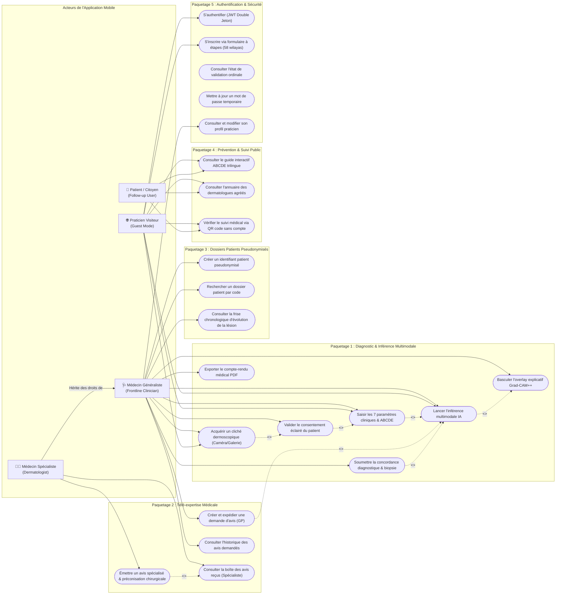
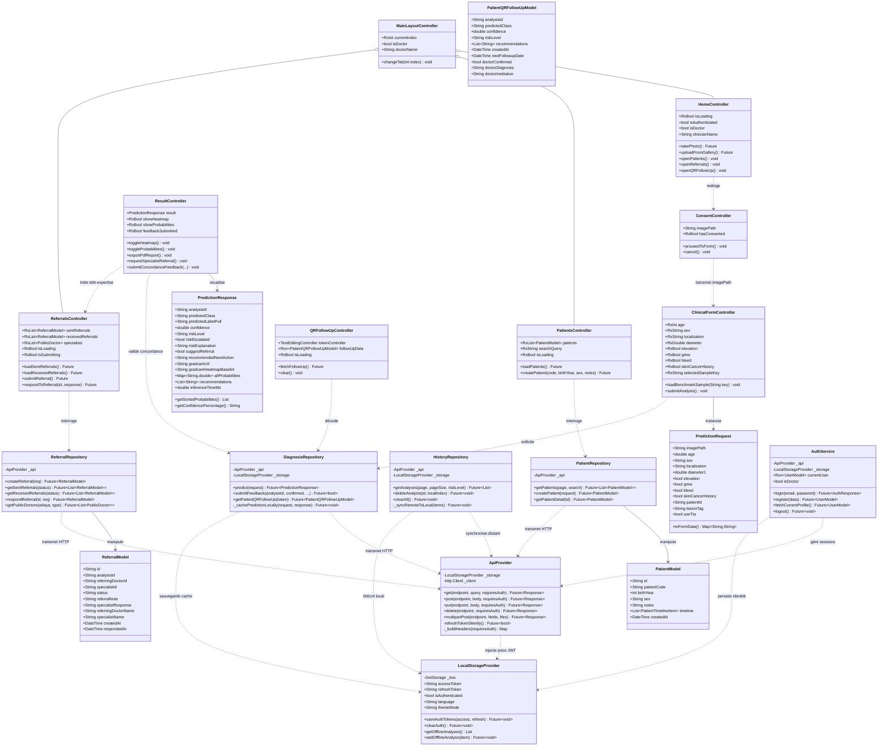
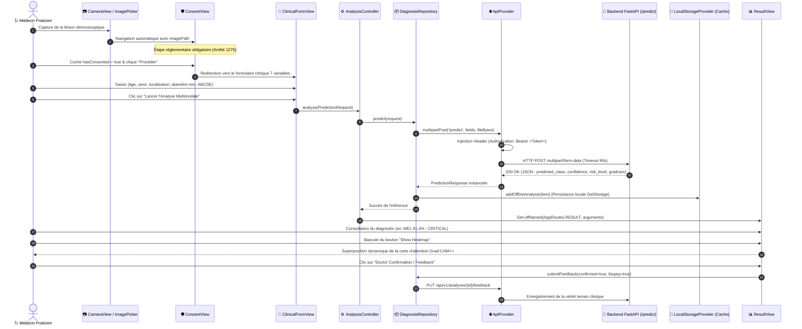
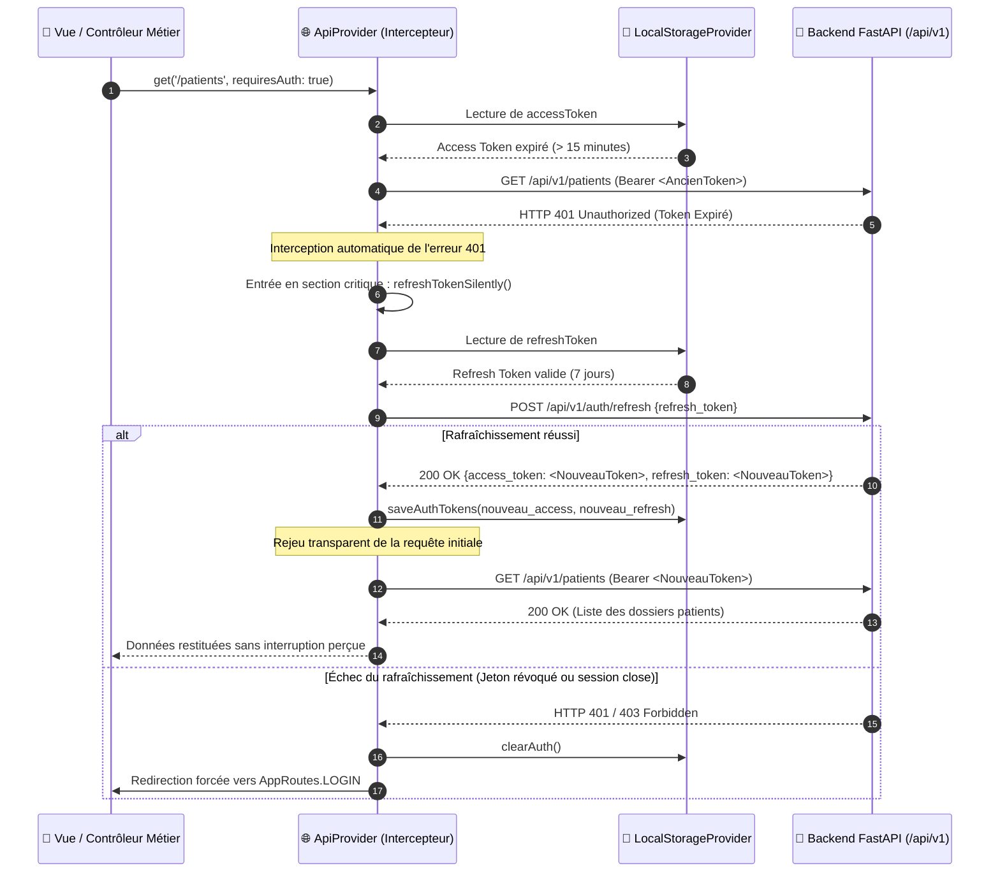
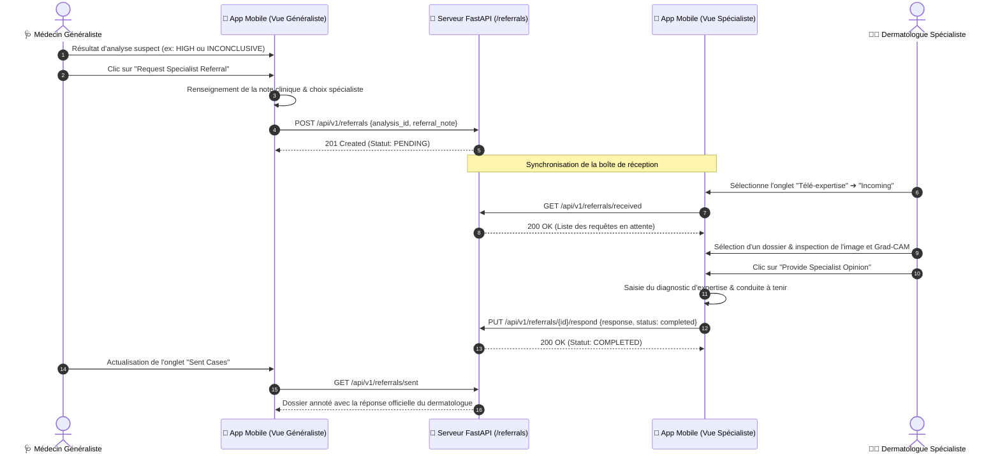
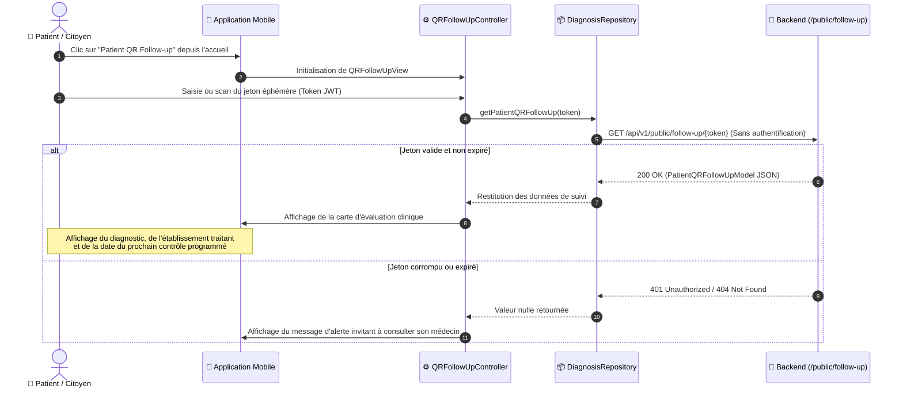
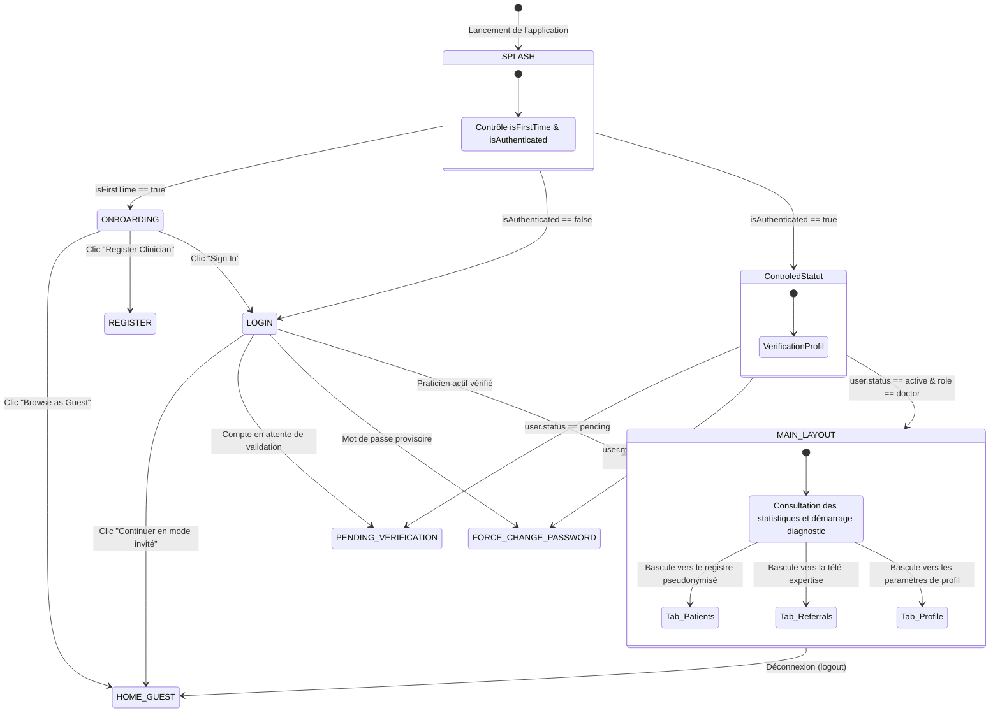
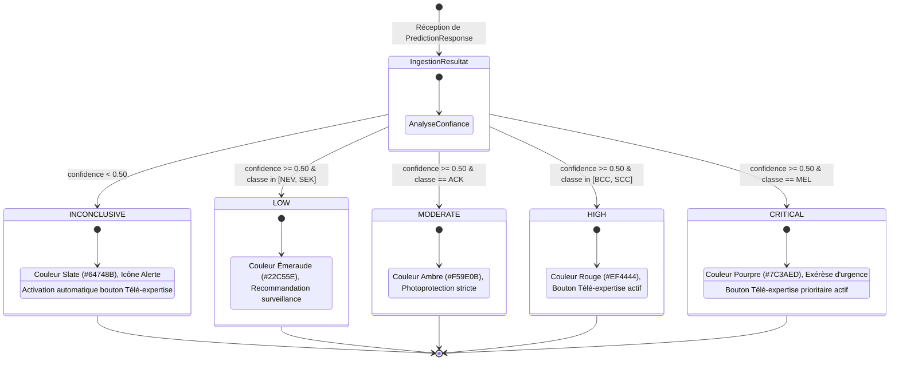
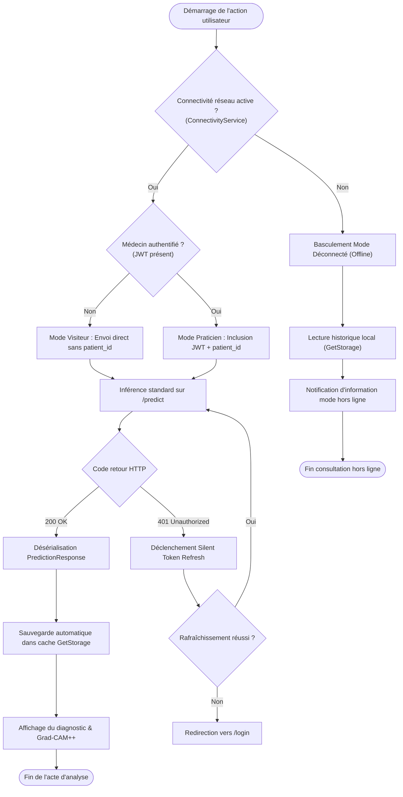

# 📱 Spécification Complète de Modélisation UML — Client Mobile MedAssist AI V2 (Flutter & GetX)
## Application Mobile d'Aide à la Décision Clinique Dermatologique et de Télé-expertise

> **Document Académique Officiel**  
> **Diplôme visé** : Master en Informatique — Spécialité : **Génie Logiciel et Applications Avancées (GLAA)**  
> **Cadre de réalisation** : Mémoire de Fin d'Études & Projet Diplôme-Startup (Arrêté Ministériel 1275)  
> **Édition** : Version 2.2 Complète — Architecture Mobile Réactive & Résiliente  
> **Date de validation** : Novembre 2026  
> **Conformité** : Normes OMG UML 2.5 (Unified Modeling Language)

---

## 📑 Sommaire Général

1. [Introduction et Choix Architecturaux du Client Mobile](#1-introduction-et-choix-architecturaux-du-client-mobile)
2. [Chapitre 1 : Modélisation Fonctionnelle — Diagramme des Cas d'Utilisation](#chapitre-1--modélisation-fonctionnelle--diagramme-des-cas-dutilisation)
   - 1.1 Diagramme Global des Cas d'Utilisation Mobile
   - 1.2 Identification des Acteurs Mobiles et Frontières
   - 1.3 Fiches Descriptives Textuelles des Cas d'Utilisation Mobiles Critiques
3. [Chapitre 2 : Modélisation Structurelle — Diagramme de Classes Logiciel (Clean Architecture / GetX)](#chapitre-2--modélisation-structurelle--diagramme-de-classes-logiciel)
   - 2.1 Conception en Couches : Presentation, Domain, Data & Provider Tiers
   - 2.2 Diagramme de Classes Détaillé des Contrôleurs, Vues et Dépôts
   - 2.3 Modèle des Données et Objets Métier Mobiles
4. [Chapitre 3 : Modélisation Dynamique — Diagrammes de Séquence Mobile](#chapitre-3--modélisation-dynamique--diagrammes-de-séquence-mobile)
   - 3.1 Séquence M-1 : Parcours d'Inférence Clinique & Consentement Éclairé Obligatoire
   - 3.2 Séquence M-2 : Interception Réseau & Rafraîchissement Silencieux du Jeton (401 Auto-Refresh)
   - 3.3 Séquence M-3 : Cycle Complet de Télé-expertise Mobile (Émission GP & Réponse Spécialiste)
   - 3.4 Séquence M-4 : Consultation et Suivi Médical Citoyen par Scan QR Code
5. [Chapitre 4 : Modélisation des États — Diagrammes d'États-Transitions](#chapitre-4--modélisation-des-états--diagrammes-détats-transitions)
   - 4.1 Machine à États : Navigation Applicative & Cycle de Session Clinique
   - 4.2 Machine à États : Évaluation Visuelle du Risque Clinique à 5 Niveaux
6. [Chapitre 5 : Modélisation des Processus — Diagramme d'Activité Client Mobile](#chapitre-5--modélisation-des-processus--diagramme-dactivité-client-mobile)
   - 5.1 Diagramme d'Activité : Gestion de la Connectivité & Résilience Offline-First
7. [Chapitre 6 : Modélisation Architecturale & Paquetages (Component & Package Diagrams)](#chapitre-6--modélisation-architecturale--paquetages)
   - 6.1 Diagramme des Paquetages Modulaires (Feature-First)
   - 6.2 Matrice de Traçabilité des Exigences Mobiles
8. [Conclusion de la Modélisation Mobile](#conclusion-de-la-modélisation-mobile)

---

## 1. Introduction et Choix Architecturaux du Client Mobile

L'application mobile **MedAssist AI (V2)** constitue le terminal de première ligne destiné aux praticiens de santé (médecins généralistes en polycliniques, centres de santé ruraux et dermatologues hospitaliers) ainsi qu'aux patients pour leur suivi post-consultation.

Pour répondre aux exigences de réactivité, de maintenabilité et de résilience dictées par le cadre d'un **Master GLAA** et d'un projet **Diplôme-Startup (Arrêté 1275)**, le client mobile a été structuré autour du patron d'architecture **Feature-First Clean Architecture** orchestré par le framework **GetX** (`get: ^4.6.6`).

Ce choix architectural apporte les garanties suivantes :
- **Découplage strict des responsabilités** : Séparation univoque entre l'interface graphique (`GetView`), la logique métier réactive (`GetxController`), l'abstraction des accès de données (`Repositories`) et les clients réseau/stockage (`Providers`).
- **Résilience déconnectée (Offline-First)** : Maintien de l'accès aux historiques et analyses antérieures via un cache persistant local (`GetStorage`) en cas d'interruption du réseau mobile 4G/WiFi.
- **Transparence de session** : Cycle de vie à double jeton JWT avec intercepteur HTTP capable de renouveler silencieusement l'accès (`Silent 401 Auto-Refresh`) sans perturber le médecin lors d'un acte clinique.
- **Rigueur réglementaire et éthique** : Intégration native de l'écran de consentement éclairé obligatoire (`ConsentScreen`), pseudonymisation des dossiers patients (`DZ-XX-PXXXX`) et gestion déterministe du risque à 5 niveaux (`INCONCLUSIVE`).

---

## Chapitre 1 : Modélisation Fonctionnelle — Diagramme des Cas d'Utilisation

### 1.1 Diagramme Global des Cas d'Utilisation Mobile



---

### 1.2 Identification des Acteurs Mobiles et Frontières

| Acteur Mobile | Description du Périmètre d'Action |
| :--- | :--- |
| **Médecin Généraliste (`GP`)** | Utilisateur principal en cabinet ou polyclinique. Il réalise l'anamnèse, recueille le consentement du patient, lance l'analyse multimodale, consulte les explications visuelles Grad-CAM++, soumet son accord diagnostique et sollicite une télé-expertise si la lésion présente un risque élevé ou indéterminé (`INCONCLUSIVE`). |
| **Dermatologue Spécialiste (`Specialist`)** | Praticien hospitalier ou libéral référent. En plus des fonctionnalités du généraliste, il accède à sa boîte de réception mobile dédiée (`Incoming Cases`) pour examiner les clichés dermoscopiques haute définition, analyser les tenseurs Grad-CAM++ et émettre formellement un avis spécialisé et des consignes d'exérèse/biopsie. |
| **Praticien Visiteur (`Guest`)** | Médecin ou étudiant en phase d'évaluation de l'application sans compte actif. Il dispose d'un accès au dépistage exploratoire direct (sauvegarde locale uniquement dans `GetStorage` sans persistance PostgreSQL), à la règle éducative ABCDE, et à l'annuaire public des praticiens. |
| **Patient / Citoyen (`Patient`)** | Utilisateur final sans identifiant permanent. Il consulte le guide de sensibilisation ABCDE et accède à la synthèse médicale de sa consultation ainsi qu'à la date de son prochain contrôle en scannant le QR code de son compte-rendu via la vue publique `/qr-followup`. |

---

### 1.3 Fiches Descriptives Textuelles des Cas d'Utilisation Mobiles Critiques

#### CU-M01 : Acquisition, Consentement Éclairé et Inférence Multimodale
- **Acteur Principal** : Médecin Généraliste / Spécialiste.
- **Préconditions** : L'application est lancée ; l'accès à la caméra ou à la galerie photo est autorisé par le système d'exploitation.
- **Scénario Nominal** :
  1. Le praticien active le module de prise de vue dermoscopique avec cercle guide de centrage et contrôle de netteté.
  2. La photo est capturée et validée.
  3. L'application bascule automatiquement vers l'écran de **Consentement Éclairé** (`ConsentView`).
  4. Le médecin confirme l'accord formel du patient pour l'enregistrement et la transmission chiffrée de ses données cliniques.
  5. L'application ouvre la fiche clinique (`ClinicalFormView`). Le praticien renseigne les 7 variables cliniques (âge, sexe, localisation, diamètre en mm, élévation, saignement, antécédents, évolution) ou sélectionne un cas de référence préchargé PAD-UFES-20.
  6. Le praticien valide la soumission ; `DiagnosisRepository` émet une requête multipart vers `/api/v1/predict`.
  7. L'écran de résultat (`ResultView`) s'affiche : diagnostic principal parmi les 6 classes, pourcentage de confiance, badge de risque à 5 niveaux, recommandations personnalisées et bouton de bascule vers la carte d'attention Grad-CAM++.
  8. Le praticien enregistre son accord de concordance (`Doctor Concordance Feedback`) avec indication d'une biopsie éventuelle.

#### CU-M02 : Évaluation et Réponse à une Demande de Télé-expertise (Spécialiste)
- **Acteur Principal** : Médecin Spécialiste.
- **Préconditions** : Le spécialiste est authentifié avec son rôle certifié (`specialist_dermatologist`).
- **Scénario Nominal** :
  1. Le spécialiste sélectionne l'onglet "Télé-expertise" du `MainLayoutView` et bascule sur le sous-onglet "Incoming (Specialist)".
  2. Le contrôleur `ReferralsController` interroge `GET /api/v1/referrals/received` via `ReferralRepository`.
  3. Le spécialiste clique sur une expertise en attente (`PENDING REVIEW`).
  4. L'application ouvre le panneau d'évaluation spécialisée (`_showSpecialistResponseSheet`).
  5. Le dermatologue inspecte le cliché, la note clinique du généraliste, et formule son avis diagnostique détaillé ainsi que la préconisation d'une biopsie urgente.
  6. Le spécialiste valide la transmission ; la requête `PUT /api/v1/referrals/{id}/respond` scelle le dossier à l'état `COMPLETED`.
  7. Le généraliste émetteur voit le statut se mettre à jour instantanément dans son onglet "Sent Cases".

#### CU-M03 : Vérification du Suivi Post-Consultation par QR Code Public
- **Acteur Principal** : Patient / Citoyen.
- **Préconditions** : Le patient dispose de son compte-rendu imprimé ou numérique comportant le QR code sécurisé.
- **Scénario Nominal** :
  1. L'utilisateur lance l'application et clique sur "Patient QR Follow-up" depuis l'accueil (sans authentification).
  2. L'utilisateur saisit ou scanne le jeton d'accès temporaire.
  3. Le contrôleur `QRFollowUpController` sollicite `GET /api/v1/public/follow-up/{token}`.
  4. L'écran restitue le diagnostic certifié, l'établissement de santé de rattachement, les recommandations préventives et la **date exacte du prochain contrôle clinique programmé**.

---

## Chapitre 2 : Modélisation Structurelle — Diagramme de Classes Logiciel

### 2.1 Conception en Couches (Clean Architecture / GetX)

L'architecture du client mobile est découpée selon les 4 couches canoniques :
1. **Presentation Tier (Vues, Contrôleurs & Bindings)** :
   - `GetView<T>` : Composants graphiques déclaratifs sans état interne, observant les variables réactives du contrôleur via `Obx()`.
   - `GetxController` : Gestionnaires d'état détenant la logique métier, les observables (`.obs`) et les méthodes d'action asynchrones.
   - `Bindings` : Modules d'injection de dépendances paresseuse (`Get.lazyPut()`) liant les contrôleurs et référentiels aux routes.
2. **Domain Tier (Modèles de Données)** :
   - Entités métiers encapsulant la sérialisation/désérialisation JSON (`fromJson`, `toJson`, `toFormData`).
3. **Repository Tier (Dépôts d'Abstraction)** :
   - Classes passerelles unifiant l'accès aux sources de données (décision entre requête réseau et lecture du cache local).
4. **Data & Provider Tier (Infrastructure & Stockage)** :
   - `ApiProvider` : Client HTTP centralisé avec gestion des en-têtes d'autorisation `Bearer`, intercepteur silencieux sur code 401 et politique de timeouts stricts.
   - `LocalStorageProvider` : Encapsulation du moteur de stockage persistant `GetStorage`.

---

### 2.2 Diagramme de Classes Détaillé des Contrôleurs, Vues et Dépôts



---

## Chapitre 3 : Modélisation Dynamique — Diagrammes de Séquence Mobile

### 3.1 Séquence M-1 : Parcours d'Inférence Clinique & Consentement Éclairé Obligatoire

Ce diagramme décrit la chaîne séquentielle rigoureuse depuis la prise de vue dermoscopique jusqu'au retour visuel de l'explicabilité Grad-CAM++ et la confirmation de concordance.



---

### 3.2 Séquence M-2 : Interception Réseau & Rafraîchissement Silencieux du Jeton (401 Auto-Refresh)

Ce diagramme formalise l'intercepteur de résilience réseau assurant qu'un médecin en consultation ne soit jamais expulsé brusquement de sa session clinique.



---

### 3.3 Séquence M-3 : Cycle Complet de Télé-expertise Mobile (Émission GP & Réponse Spécialiste)



---

### 3.4 Séquence M-4 : Consultation et Suivi Médical Citoyen par Scan QR Code



---

## Chapitre 4 : Modélisation des États — Diagrammes d'États-Transitions

### 4.1 Machine à États : Navigation Applicative & Cycle de Session Clinique



---

### 4.2 Machine à États : Évaluation Visuelle du Risque Clinique à 5 Niveaux



---

## Chapitre 5 : Modélisation des Processus — Diagramme d'Activité Client Mobile

### 5.1 Diagramme d'Activité : Gestion de la Connectivité & Résilience Offline-First



---

## Chapitre 6 : Modélisation Architecturale & Paquetages

### 6.1 Diagramme des Paquetages Modulaires (Feature-First)

```mermaid
flowchart TB
    subgraph App_Package ["Paquetage Applicatif Global : lib/"]
        
        subgraph Core_Layer ["Couche Transversale : core/"]
            Services["Services Singuliers :<br/>AuthService, ConnectivityService, PdfService"]
            Middleware["Garde de Navigation :<br/>AuthMiddleware"]
            Utils["Utilitaires :<br/>Constants, DateUtils, ImageUtils"]
        end

        subgraph Config_Layer ["Couche Configuration : app/"]
            Routes["Routage :<br/>AppRoutes, AppPages"]
            Theme["Thème & Chartes :<br/>AppTheme, AppColors"]
            Translations["i18n Trilingue :<br/>ar.dart, fr.dart, en.dart"]
            ApiConfig["Configuration API :<br/>ApiConstants, ApiConfig"]
        end

        subgraph Data_Layer ["Couche Données : data/"]
            Models["Modèles Métier :<br/>PredictionRequest, PredictionResponse, PatientModel, ReferralModel"]
            Repositories["Dépôts Abstraction :<br/>DiagnosisRepository, ReferralRepository, PatientRepository, HistoryRepository"]
            Providers["Fournisseurs Bas Niveau :<br/>ApiProvider (HTTP), LocalStorageProvider (GetStorage)"]
        end

        subgraph Modules_Layer ["Couche Modules Fonctionnels : modules/"]
            direction TB
            Mod_Auth["Module Auth (Login, Register, Pending)"]
            Mod_Layout["Module MainLayout (4 Tabs)"]
            Mod_Home["Module Home (Clinique & Guest)"]
            Mod_Consent["Module Consentement Éclairé"]
            Mod_Camera["Module Caméra Dermoscopique"]
            Mod_Form["Module Formulaire Clinique 7 Caractéristiques"]
            Mod_Result["Module Résultat & Grad-CAM++ Overlay"]
            Mod_Patients["Module Patients & Frise Chronologique"]
            Mod_Referrals["Module Télé-expertise (GP & Spécialiste)"]
            Mod_QR["Module Suivi Patient QR Code"]
            Mod_Education["Module ABCDE Trilingue"]
            Mod_Directory["Module Annuaire Public des Médecins"]
        end

    end

    %% Dépendances entre paquetages
    Modules_Layer ..> Data_Layer : consomme référentiels et modèles
    Modules_Layer ..> Core_Layer : utilise services et gardes
    Modules_Layer ..> Config_Layer : observe thèmes et routes
    Data_Layer ..> Config_Layer : lit constantes API
    Core_Layer ..> Data_Layer : pilote sessions et stockage
```

---

### 6.2 Matrice de Traçabilité des Exigences Mobiles

| Code Exigence | Intitulé Spécifique Mobile | Artefact UML Référent | Implémentation Logicielle Dart |
| :--- | :--- | :--- | :--- |
| **REQ-M-01** | Prise de vue dermoscopique avec cercle guide et contrôle qualité | Cas d'utilisation CU-M01, Diagramme Séquence M-1 | `CameraView`, `CameraGetxController` |
| **REQ-M-02** | Consentement éclairé obligatoire préalable à tout transfert | Diagramme de Séquence M-1, Machine à états | `ConsentView`, `ConsentController` |
| **REQ-M-03** | Saisie des 7 variables cliniques et sélection d'échantillons de test | Diagramme de Classes, Formulaire Clinique | `ClinicalFormView`, `AgeSlider`, `YesNoSelector` |
| **REQ-M-04** | Rendu explicable de la carte thermique Grad-CAM++ par bascule | Diagramme de Séquence M-1 | `ResultView._buildImageViewer()` |
| **REQ-M-05** | Affichage du badge de risque à 5 niveaux avec gestion d'incertitude | Machine à États 4.2 | `RiskLevelBadge` (avec cas `INCONCLUSIVE`) |
| **REQ-M-06** | Émission et suivi de télé-expertise médicale par le généraliste | Cas d'utilisation CU-M01, Diagramme Séquence M-3 | `ReferralsView._buildSentReferralsTab()` |
| **REQ-M-07** | Traitement et réponse formelle à l'expertise par le dermatologue | Cas d'utilisation CU-M02, Diagramme Séquence M-3 | `ReferralsView._buildReceivedReferralsTab()` |
| **REQ-M-08** | Gestion de dossiers patients pseudonymisés et chronologie lésionnelle | Diagramme de Classes, Modules Patients | `PatientsView`, `PatientDetailView` |
| **REQ-M-09** | Vérification publique de suivi post-consultation par QR code | Cas d'utilisation CU-M03, Diagramme Séquence M-4 | `QRFollowUpView`, `QRFollowUpController` |
| **REQ-M-10** | Résilience déconnectée et mise en cache transparente | Diagramme d'Activité 5.1 | `LocalStorageProvider`, `HistoryRepository` |
| **REQ-M-11** | Double jeton JWT et rafraîchissement automatique silencieux sur 401 | Diagramme de Séquence M-2 | `ApiProvider.refreshTokenSilently()` |
| **REQ-M-12** | Support trilingue intégral (AR/FR/EN) avec support RTL | Paquetage Configuration | `AppTranslations`, `ar.dart`, `fr.dart`, `en.dart` |

---

## Conclusion de la Modélisation Mobile

Cette spécification d'ingénierie logicielle fournit la modélisation formelle et exhaustive du client mobile **MedAssist AI V2** sous Flutter et GetX.

Elle démontre l'alignement rigoureux entre les objectifs cliniques (dépistage précoce, explicabilité visuelle, télé-expertise médicale décentralisée), les impératifs éthiques et réglementaires (consentement éclairé, pseudonymisation, gestion du doute algorithmique) et l'excellence de conception logicielle requise pour l'obtention du diplôme de **Master 2 en Génie Logiciel et Applications Avancées (GLAA)** dans le cadre du projet **Diplôme-Startup (Arrêté Ministériel 1275)**.

