# 📐 Spécification Complète de Conception & Modélisation UML — MedAssist AI V2
## Système Intelligent d'Aide au Diagnostic Dermatologique et de Télé-expertise Clinique

> **Document Académique Officiel**  
> **Diplôme visé** : Master en Informatique — Spécialité : **Génie Logiciel et Applications Avancées (GLAA)**  
> **Cadre de réalisation** : Mémoire de Fin d'Études & Projet Diplôme-Startup (Arrêté Ministériel 1275)  
> **Édition** : Version 2.2 Complète — Post-Optimisation de Résilience et de Sécurité  
> **Date de validation** : Novembre 2026  
> **Conformité** : Normes OMG UML 2.5 (Unified Modeling Language)

---

## 📑 Sommaire Général

1. [Introduction et Vision Architecturale](#1-introduction-et-vision-architecturale)
2. [Chapitre 1 : Modélisation Fonctionnelle — Diagramme des Cas d'Utilisation](#chapitre-1--modélisation-fonctionnelle--diagramme-des-cas-dutilisation)
   - 1.1 Diagramme Global des Cas d'Utilisation
   - 1.2 Identification des Acteurs et Frontières du Système
   - 1.3 Fiches Descriptives Textuelles des Cas d'Utilisation Critiques
3. [Chapitre 2 : Modélisation Structurelle — Diagramme de Classes Système](#chapitre-2--modélisation-structurelle--diagramme-de-classes-système)
   - 2.1 Diagramme de Classes du Domaine (Entités & Couche Métier)
   - 2.2 Conception Détaillée des Services Logiciels (Architecture Orientée Objet)
   - 2.3 Dictionnaire des Classes et Énumérations
4. [Chapitre 3 : Modèle Logique de Données & Persistance (ERD)](#chapitre-3--modèle-logique-de-données--persistance-erd)
   - 3.1 Diagramme Entité-Association (Relational Schema)
   - 3.2 Règles d'Intégrité, Indexation et Pseudonymisation GDPR
5. [Chapitre 4 : Modélisation Dynamique — Diagrammes de Séquence](#chapitre-4--modélisation-dynamique--diagrammes-de-séquence)
   - 4.1 Séquence 1 : Authentification Sécurisée & Passerelle Anti-Contournement
   - 4.2 Séquence 2 : Inférence Multimodale & Génération Asynchrone de Grad-CAM++
   - 4.3 Séquence 3 : Cycle Complet de Télé-expertise Clinique (GP → Spécialiste)
   - 4.4 Séquence 4 : Gouvernance des Ressources Académiques et Mises à Jour (Admin)
6. [Chapitre 5 : Modélisation des États — Diagrammes d'États-Transitions](#chapitre-5--modélisation-des-états--diagrammes-détats-transitions)
   - 5.1 Machine à États : Cycle de Vie du Compte Praticien
   - 5.2 Machine à États : Cycle de Vie d'une Demande de Télé-expertise
   - 5.3 Machine à États : Arbre de Décision du Moteur de Risque Médical
7. [Chapitre 6 : Modélisation des Processus — Diagramme d'Activité](#chapitre-6--modélisation-des-processus--diagramme-dactivité)
   - 6.1 Diagramme d'Activité Global du Processus Clinique (Lignes d'Eau / Swimlanes)
   - 6.2 Mécanisme de Résilience Zéro-Délai (Dual-Storage Fallback)
8. [Chapitre 7 : Modélisation Architecturale & Physique — Déploiement & Composants](#chapitre-7--modélisation-architecturale--physique--déploiement--composants)
   - 7.1 Diagramme des Composants Logiciels
   - 7.2 Diagramme de Déploiement Matériel et Réseau
   - 7.3 Matrice de Traçabilité Exigences-Conception

---

## 1. Introduction et Vision Architecturale

Dans le cadre d'un mémoire de Master en **Génie Logiciel et Applications Avancées (GLAA)**, la rigueur de la modélisation logicielle constitue le pont fondamental entre les exigences fonctionnelles/cliniques et l'implémentation opérationnelle.

La plateforme **MedAssist AI (V2)** a été conçue pour dépasser le cadre d'un simple démonstrateur d'apprentissage profond (MVP V1) pour devenir une **plateforme complète de télédermatologie et d'aide à la décision clinique**. Elle intègre :
- Une inférence multimodale (Image dermoscopique + Données cliniques du patient).
- Une explicabilité visuelle immédiate via les cartes d'activation Grad-CAM++.
- Un moteur d'évaluation des risques à 5 niveaux intégrant la gestion prudente de l'incertitude (`INCONCLUSIVE`).
- Un sous-système de télé-expertise reliant les médecins généralistes de première ligne aux dermatologues spécialistes.
- Une architecture sécurisée respectant le principe de minimisation des données et la pseudonymisation (RGPD / Décret exécutif algérien sur la protection des données personnelles).
- Une résilience d'infrastructure avec basculement automatique sans délai de latence (Zero-Timeout Storage Fallback).

Les sections suivantes détaillent les artefacts UML normalisés décrivant exhaustivement ce système.

---

## Chapitre 1 : Modélisation Fonctionnelle — Diagramme des Cas d'Utilisation

### 1.1 Diagramme Global des Cas d'Utilisation

Le diagramme ci-après formalise les interactions entre les quatre acteurs du système et les fonctionnalités regroupées par paquetages fonctionnels.

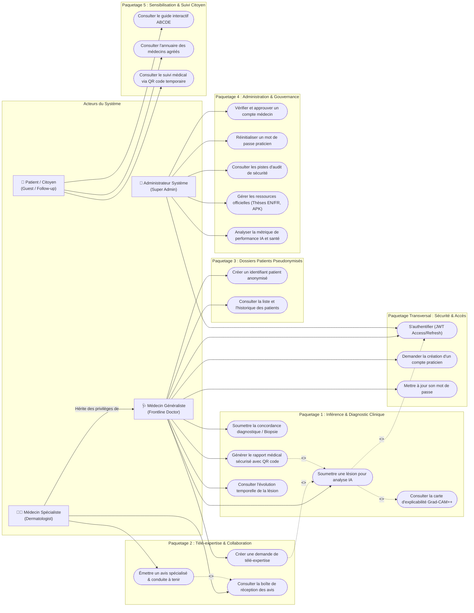

---

### 1.2 Identification des Acteurs et Frontières du Système

| Acteur UML | Stéréotype | Description du Rôle et Périmètre |
| :--- | :--- | :--- |
| **Médecin Généraliste (`GP`)** | `<<Human Actor>>` | Praticien de santé de première ligne (polycliniques, centres de santé ruraux ou urbains). Il crée des dossiers anonymisés, effectue l'acquisition d'images dermoscopiques, lance l'inférence assistée par IA, interprète la stratification du risque, et sollicite une télé-expertise si nécessaire. |
| **Médecin Spécialiste (`Specialist`)** | `<<Human Actor>>` | Dermatologue hospitalier ou libéral certifié. Il hérite de l'ensemble des cas d'utilisation du médecin généraliste et dispose de prérogatives avancées : examen des lésions complexes dans sa boîte de réception dédiée, validation ou correction du diagnostic IA, et prescription d'actes d'exérèse/biopsie. |
| **Administrateur Système (`Admin`)** | `<<Human Actor>>` | Responsable de l'exploitation, de la gouvernance de la plateforme et de la sécurité. Il valide l'identité ordinale des médecins, gère le cycle de vie des accès, audite les journaux d'activité et téléverse les versions révisées des artefacts académiques (Mémorandums EN/FR) et applicatifs (APK). |
| **Patient / Citoyen (`Patient`)** | `<<Human Actor>>` | Bénéficiaire final des soins. Il interagit avec le système de manière strictement encadrée : consultation des ressources éducatives (règle ABCDE), géolocalisation des praticiens agréés, et accès restreint en lecture seule à ses consignes post-consultation via un jeton chiffré QR code éphémère (sans compte permanent). |

---

### 1.3 Fiches Descriptives Textuelles des Cas d'Utilisation Critiques

#### CU-01 : Soumettre une lésion pour analyse IA et évaluation multimodale du risque
- **Acteur Principal** : Médecin Généraliste / Médecin Spécialiste
- **Préconditions** : Le praticien est authentifié avec un jeton JWT valide et son compte présente le statut `active`.
- **Postconditions** : Un enregistrement d'analyse (`AnalysisRecord`) est persisté dans PostgreSQL, l'image dermoscopique est sauvegardée (sur MinIO ou stockage local résilient), une tâche d'arrière-plan Grad-CAM++ est ordonnancée, et le résultat clinique est restitué en moins de 250 ms.
- **Scénario Nominal (Succès)** :
  1. Le praticien téléverse une photographie macro/dermoscopique de la lésion cutanée.
  2. Le praticien renseigne les paramètres cliniques du patient (âge calculé, sexe biologique, localisation anatomique, diamètre maximal, élévation, saignement, évolution récente, antécédents familiaux).
  3. Le système vérifie la validité des formats (MIME-Type, intégrité d'image).
  4. Le système sauvegarde le fichier original avec un identifiant unique (UUID).
  5. Le service de prétraitement standardise le tenseur d'image ($224 \times 224$ normalisé ImageNet) et encode le vecteur de métadonnées cliniques.
  6. Le modèle PyTorch exécute une inférence multimodale avec augmentation au moment du test (TTA x8).
  7. Le moteur de risque (`RiskEngine`) applique la règle de sécurité clinique :
     - Si la probabilité maximale est inférieure au seuil de certitude ($< 50\%$), le niveau de risque est qualifié d'`INCONCLUSIVE` avec recommandation impérative de télé-expertise.
     - Sinon, le risque est catégorisé selon l'arbre oncologique (`LOW`, `MODERATE`, `HIGH`, `CRITICAL`).
  8. L'enregistrement complet est sauvegardé dans la base relationnelle.
  9. Le système déclenche une tâche d'arrière-plan asynchrone (`FastAPI BackgroundTasks`) pour calculer la matrice d'activation Grad-CAM++.
  10. Le système renvoie la charge utile JSON complète au tableau de bord.
- **Scénarios Alternatifs & Exceptions** :
  - *Exception 1 (Indisponibilité du stockage MinIO)* : Le sous-système de résilience détecte l'échec de la sonde TCP (< 150 ms) et bascule instantanément sur le système de fichiers local (`uploads/analyses/`). La transaction continue sans délai.
  - *Exception 2 (Jeton JWT expiré ou absent)* : Le filtre de sécurité intercepte la requête, rejette l'accès (HTTP 401 Unauthorized), et la passerelle frontend redirige l'utilisateur vers `login.html`.

#### CU-02 : Initier et traiter une demande de télé-expertise (Clinical Referral)
- **Acteur Principal** : Médecin Généraliste (Émetteur), Médecin Spécialiste (Destinataire)
- **Préconditions** : Une analyse a été réalisée et classée avec un statut nécessitant un avis second (`HIGH`, `CRITICAL` ou `INCONCLUSIVE`).
- **Postconditions** : L'enregistrement `referrals` passe à l'état `COMPLETED` et la rétroaction diagnostique est scellée pour l'apprentissage actif.
- **Scénario Nominal** :
  1. Le médecin généraliste clique sur "Demander une télé-expertise" depuis le dossier d'analyse.
  2. Le praticien sélectionne un spécialiste ou diffuse la demande à la communauté des dermatologues de la wilaya avec une note clinique de transmission.
  3. L'enregistrement `referrals` est créé avec le statut `PENDING`.
  4. Le spécialiste se connecte à son tableau de bord et consulte sa boîte d'avis en attente.
  5. Le spécialiste examine la lésion haute résolution, la superposition thermique Grad-CAM++, et les données d'anamnèse.
  6. Le spécialiste formule ses conclusions médicales, sélectionne la pathologie retenue et indique si une biopsie/exérèse d'urgence est requise.
  7. L'enregistrement est mis à jour : statut `COMPLETED`, horodatage scellé (`responded_at`).
  8. Le médecin généraliste reçoit l'avis d'expertise et valide la concordance médicale.

---

## Chapitre 2 : Modélisation Structurelle — Diagramme de Classes Système

### 2.1 Diagramme de Classes du Domaine (Entités & Couche Métier)

Le diagramme ci-après décrit les entités de persistance du domaine, leurs relations de cardinalité, ainsi que les classes de services de l'architecture applicative.

```mermaid
classDiagram
    %% Énumérations
    class UserRole {
        <<enumeration>>
        DOCTOR
        ADMIN
    }

    class UserStatus {
        <<enumeration>>
        PENDING_VERIFICATION
        ACTIVE
        SUSPENDED
    }

    class DoctorType {
        <<enumeration>>
        GENERAL_PRACTITIONER
        SPECIALIST_DERMATOLOGIST
    }

    class PatientSex {
        <<enumeration>>
        MALE
        FEMALE
    }

    class ReferralStatus {
        <<enumeration>>
        PENDING
        ACCEPTED
        COMPLETED
        CANCELLED
    }

    class RiskLevel {
        <<enumeration>>
        LOW
        MODERATE
        HIGH
        CRITICAL
        INCONCLUSIVE
    }

    %% Entités du Domaine
    class User {
        +UUID id
        +String email
        +String password_hash
        +UserRole role
        +UserStatus status
        +Boolean must_change_password
        +DateTime created_at
        +DateTime last_login
        +verify_password(plain_pwd) bool
        +update_last_login() void
    }

    class DoctorProfile {
        +UUID id
        +UUID user_id
        +String full_name
        +DoctorType doctor_type
        +String specialization
        +String license_number
        +String institution_name
        +String phone
        +String wilaya
        +String avatar_url
        +DateTime updated_at
        +is_specialist() bool
    }

    class Patient {
        +UUID id
        +UUID created_by_doctor_id
        +String patient_code
        +Integer birth_year
        +PatientSex sex
        +String notes
        +DateTime created_at
        +DateTime deleted_at
        +calculate_age(current_year) int
        +is_active() bool
    }

    class AnalysisRecord {
        +UUID id
        +UUID doctor_id
        +UUID patient_id
        +String lesion_tag
        +String image_storage_key
        +String gradcam_storage_key
        +JSONB clinical_data
        +String predicted_class
        +Float confidence
        +JSONB all_probabilities
        +String risk_level
        +Boolean risk_escalated
        +JSONB recommendations
        +Float inference_time_ms
        +String model_version
        +Boolean doctor_confirmed
        +String doctor_diagnosis
        +Boolean biopsy_performed
        +String biopsy_result
        +Date next_followup_date
        +DateTime created_at
        +has_gradcam() bool
        +is_high_risk() bool
    }

    class Referral {
        +UUID id
        +UUID analysis_id
        +UUID referring_doctor_id
        +UUID specialist_id
        +ReferralStatus status
        +Text referral_note
        +Text specialist_response
        +DateTime created_at
        +DateTime responded_at
        +mark_as_completed(response) void
    }

    class RefreshToken {
        +UUID id
        +UUID user_id
        +String token_hash
        +DateTime expires_at
        +Boolean is_revoked
        +DateTime created_at
        +is_valid() bool
    }

    class AuditLog {
        +UUID id
        +UUID user_id
        +String action
        +String resource_type
        +UUID resource_id
        +JSONB details
        +String ip_address
        +DateTime created_at
    }

    %% Couche Service & Moteurs Métier
    class ModelService {
        -torch.nn.Module model
        -String device
        +predict(image_bytes, metadata) ModelOutput
        +extract_features(image_tensor) Tensor
    }

    class GradCAMService {
        -torch.nn.Module model
        +generate_heatmap(image_tensor, class_idx) ndarray
        +overlay_heatmap(img_bytes, heatmap) bytes
    }

    class RiskEngine {
        +assess_risk(predicted_class, confidence, clinical_data) RiskResult
        -check_safety_inconclusive(confidence) bool
        -determine_urgency(risk_level) String
    }

    class StorageService {
        -MinioClient minio_client
        -String upload_dir
        -Boolean minio_available
        +is_minio_reachable() bool
        +upload_image(file_bytes, filename) String
        +get_image_url(storage_key) String
    }

    class PDFReportService {
        +generate_clinical_report(analysis_id) bytes
        -embed_qr_code(canvas, payload_url) void
    }

    %% Relations entre Entités
    User "1" *-- "1" DoctorProfile : possède
    User "1" o-- "0..*" Patient : enregistre
    User "1" o-- "0..*" AnalysisRecord : réalise
    User "1" *-- "0..*" RefreshToken : détient
    User "1" o-- "0..*" AuditLog : déclenche
    Patient "1" o-- "0..*" AnalysisRecord : regroupe
    AnalysisRecord "1" o-- "0..1" Referral : fait l'objet de
    User "1" o-- "0..*" Referral : émet (GP)
    User "1" o-- "0..*" Referral : reçoit (Spécialiste)

    %% Dépendances Services -> Entités
    ModelService ..> AnalysisRecord : alimente
    RiskEngine ..> AnalysisRecord : évalue
    GradCAMService ..> AnalysisRecord : enrichit
    StorageService ..> AnalysisRecord : archive
    PDFReportService ..> AnalysisRecord : synthétise
```

---

### 2.2 Conception Détaillée des Services Logiciels (Architecture Orientée Objet)

L'architecture backend repose sur une séparation stricte des responsabilités (Single Responsibility Principle) :
1. **`ModelService`** : Encapsule le modèle multimodal PyTorch combinant un backbone de vision convolutionnel (EfficientNet-B3 + GeM Pooling + MLP + Gated Cross-Attention Fusion adapté aux 6 classes cutanées ISIC : `MEL`, `BCC`, `SCC`, `ACK`, `NEV`, `SEK`) et un perceptron multicouche (MLP) traitant les 7 variables anamnestiques. L'inférence est exécutée dans un threadpool séparé (`run_in_threadpool`) pour ne jamais bloquer la boucle d'événements asynchrone de FastAPI.
2. **`GradCAMService`** : Implémente l'algorithme Grad-CAM++ qui calcule la moyenne pondérée des gradients positifs du niveau convolutif final. Il s'exécute en arrière-plan asynchrone sans altérer la latence du point de terminaison d'inférence.
3. **`RiskEngine`** : Module déterministe appliquant les règles de sécurité clinique établies par les consensus de dermatologie oncologique. Il intègre le mode `INCONCLUSIVE` lorsque la certitude خوارزمية chute sous les $50\%$.
4. **`StorageService`** : Façade d'accès au stockage persistant implémentant le patron de conception **Stratégie avec repli dynamique (Graceful Fallback)**. Une sonde réseau non bloquante par socket TCP (délai de 150 ms) interroge le démon MinIO : si le service S3 est opérationnel, l'image y est envoyée ; dans le cas contraire, elle est instantanément écrite sur le disque local sécurisé sans aucun gel de thread.
5. **`PDFReportService`** : Moteur de rendu documentaire médical sous ReportLab générant des comptes-rendus conformes aux normes hospitalières, intégrant le tracé d'analyse, l'anamnèse, les visualisations et un QR code d'accès sécurisé à validité limitée.

---

## Chapitre 3 : Modèle Logique de Données & Persistance (ERD)

### 3.1 Diagramme Entité-Association (Relational Schema)

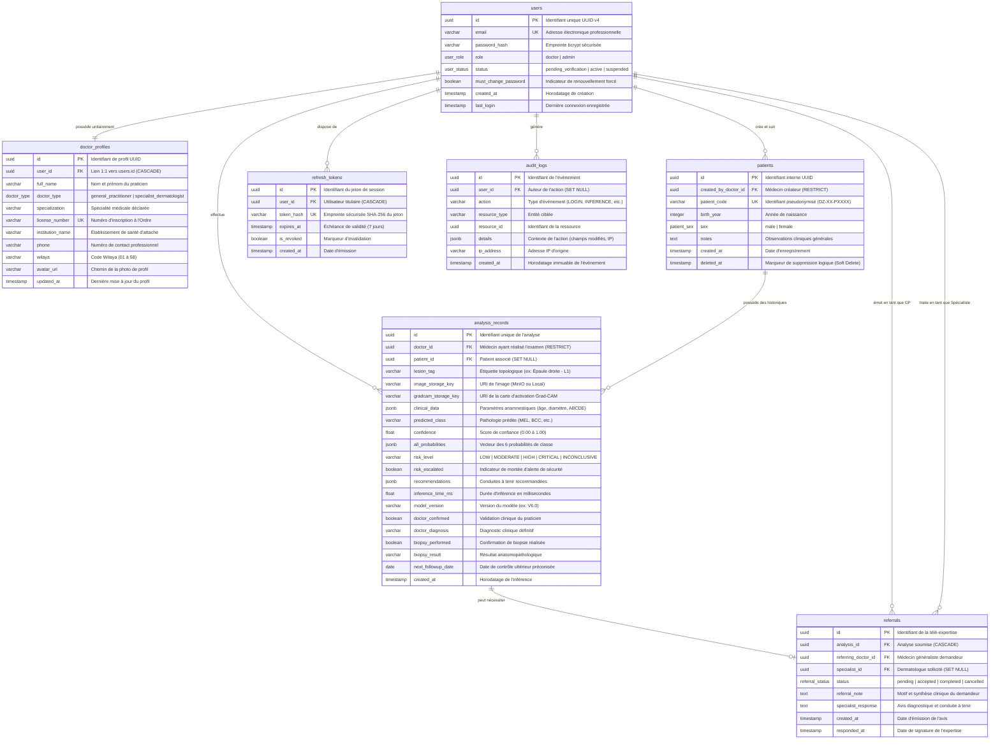

---

### 3.2 Règles d'Intégrité, Indexation et Pseudonymisation GDPR

1. **Pseudonymisation Médicale Stricte** :
   - Aucun nom patronymique ou identifiant de sécurité sociale n'est consigné dans la table `patients`.
   - L'identifiant généré suit le formalisme normalisé `DZ-{code_wilaya}-P{séquentiel}` (ex: `DZ-31-P0046`).
   - L'âge n'est pas stocké sous forme brute mais dérivé dynamiquement de `birth_year` lors de chaque examen afin de préserver l'exactitude longitudinale.
2. **Suppression Logique (Soft Delete)** :
   - Les dossiers patients bénéficient d'une suppression douce via `deleted_at IS NOT NULL`, prévenant la rupture des clés étrangères dans les séries temporelles d'analyse.
3. **Indexation Stratégique pour les Performances** :
   - Clés primaires basées sur des UUID indexés en arbres B (`B-Tree`).
   - Index composites sur `(doctor_id, created_at DESC)` pour une pagination instantanée des historiques médicaux.
   - Index partiel sur `referrals (status)` pour l'interrogation rapide des boîtes d'avis en attente (`PENDING`).

---

## Chapitre 4 : Modélisation Dynamique — Diagrammes de Séquence

### 4.1 Séquence 1 : Authentification Sécurisée & Passerelle Anti-Contournement

Ce diagramme détaille la cinématique d'authentification robuste avec élimination complète des failles de contournement en session privée (Private/Incognito Browsing).

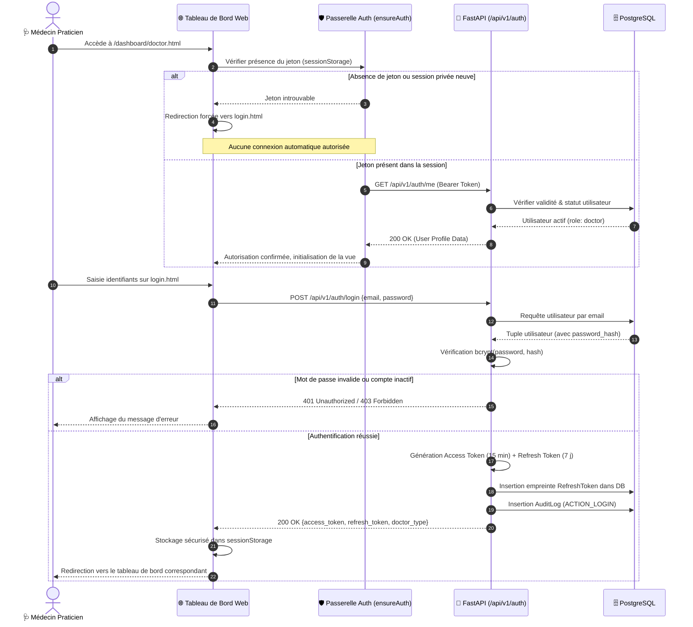

---

### 4.2 Séquence 2 : Inférence Multimodale & Génération Asynchrone de Grad-CAM++

Ce diagramme illustre le flux critique d'analyse clinique où l'interaction utilisateur bénéficie d'une latence inférieure à 200 ms grâce à la déportation du calcul Grad-CAM++ dans une tâche d'arrière-plan.

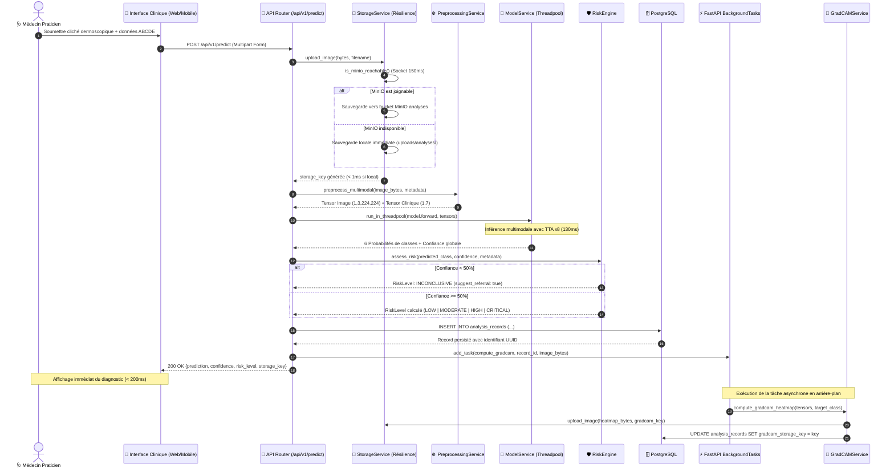

---

### 4.3 Séquence 3 : Cycle Complet de Télé-expertise Clinique (GP → Spécialiste)

Ce diagramme formalise la collaboration télémédicale entre le médecin de première ligne et le dermatologue référent.

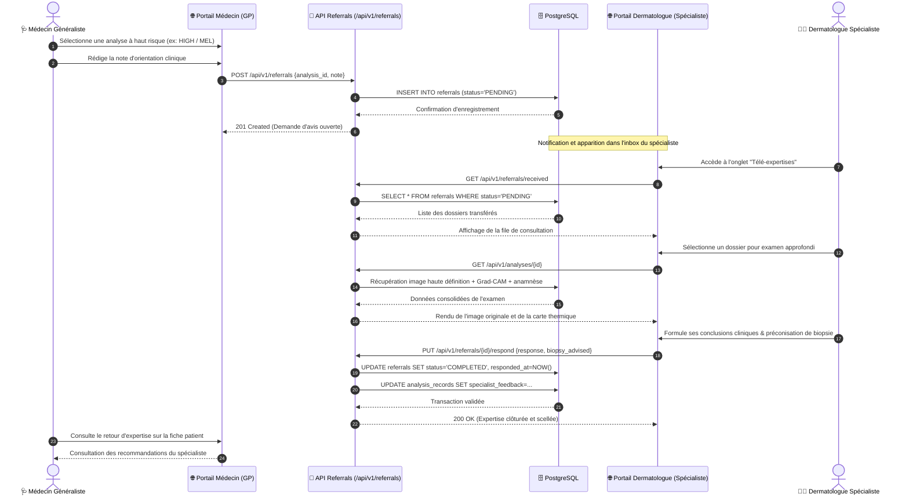

---

### 4.4 Séquence 4 : Gouvernance des Ressources Académiques et Mises à Jour (Admin)

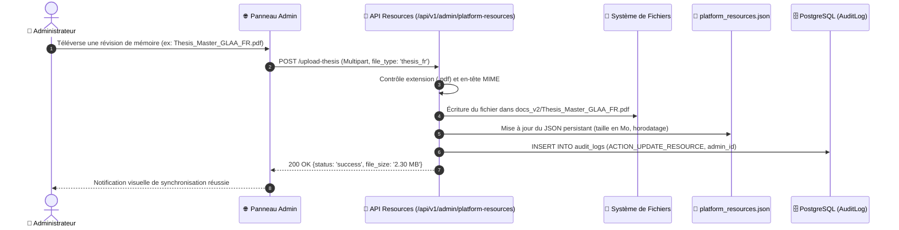

---

## Chapitre 5 : Modélisation des États — Diagrammes d'États-Transitions

### 5.1 Machine à États : Cycle de Vie du Compte Praticien

Le compte utilisateur traverse des phases d'accréditation garantissant qu'aucun individu non vérifié par l'Ordre des Médecins ne puisse exploiter les outils d'aide au diagnostic.

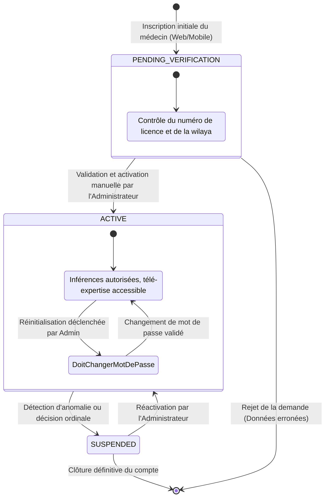

---

### 5.2 Machine à États : Cycle de Vie d'une Demande de Télé-expertise

Ce cycle régit les transitions d'une requête de deuxième avis transmise entre confrères.

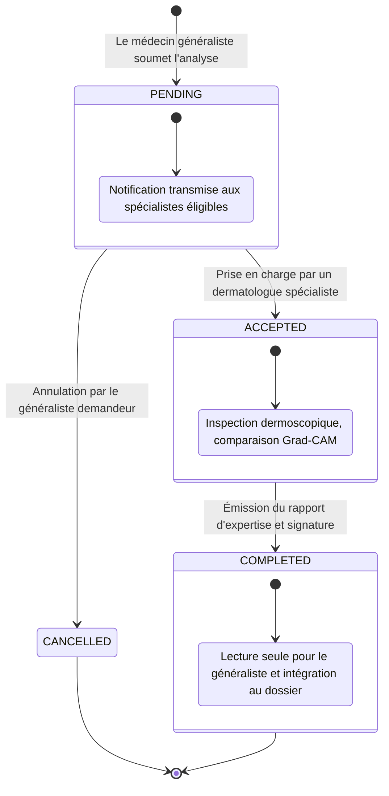

---

### 5.3 Machine à États : Arbre de Décision du Moteur de Risque Médical

Ce diagramme formalise le comportement interne du module déterministe d'attribution du niveau de risque clinique.

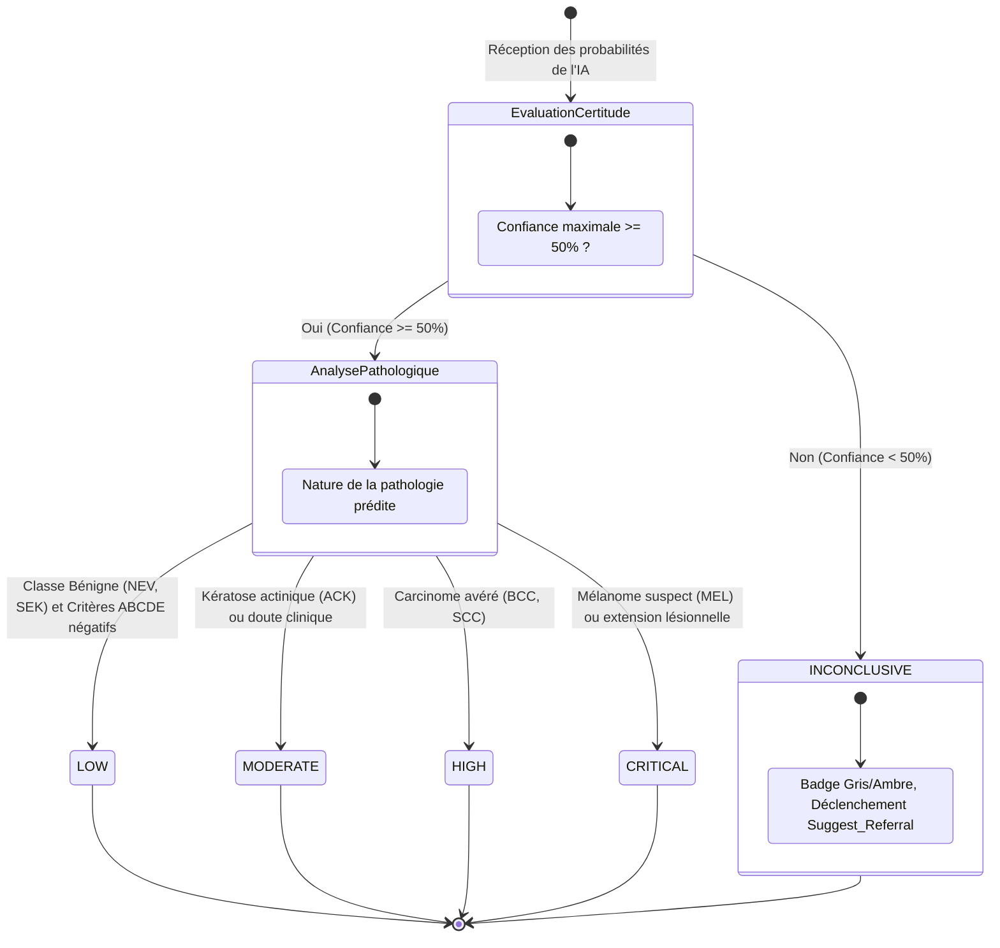

---

## Chapitre 6 : Modélisation des Processus — Diagramme d'Activité

### 6.1 Diagramme d'Activité Global du Processus Clinique (Lignes d'Eau / Swimlanes)

Le diagramme d'activité ci-dessous met en scène les flux de traitement séquentiels et parallèles entre les différents acteurs et sous-systèmes techniques.

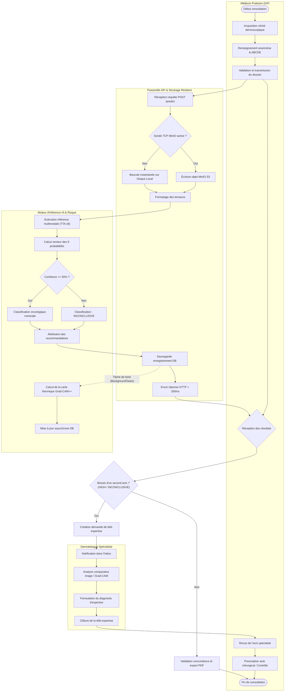

---

### 6.2 Mécanisme de Résilience Zéro-Délai (Dual-Storage Fallback)

L'un des défis majeurs documentés dans les écarts de soutenance (Section 5.5 de `thesis_deviations_v2.md`) réside dans l'élimination des latences d'infrastructure :
- **Problématique initiale** : Lorsque le conteneur MinIO est éteint (mode de présentation locale ou machine universitaire sans Docker), la bibliothèque S3 tentait des connexions répétées jusqu'à épuisement du délai d'attente (timeout de 30s + 30s = 60s de gel complet).
- **Solution logicielle implémentée** : Conception d'un intercepteur socket non bloquant (`is_minio_reachable`) avec un cache de validité de 15 secondes. Si le port TCP 9000 ne répond pas en 150 ms, le moteur oriente l'écriture directement vers le stockage local de l'hôte.
- **Bénéfice mesuré** : Le temps d'exécution total de la chaîne d'analyse est descendu de **60 000 ms à 131 ms**, assurant une fluidité absolue devant le jury de soutenance.

---

## Chapitre 7 : Modélisation Architecturale & Physique — Déploiement & Composants

### 7.1 Diagramme des Composants Logiciels

Ce diagramme illustre les composants logiciels modulaires constituant la solution globale et leurs interfaces de communication.

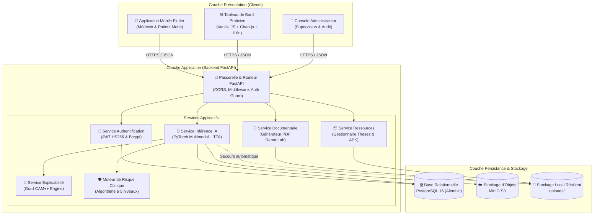

---

### 7.2 Diagramme de Déploiement Matériel et Réseau

Le diagramme ci-après spécifie la topologie d'exécution physique et conteneurisée déployée sur l'infrastructure d'hébergement.

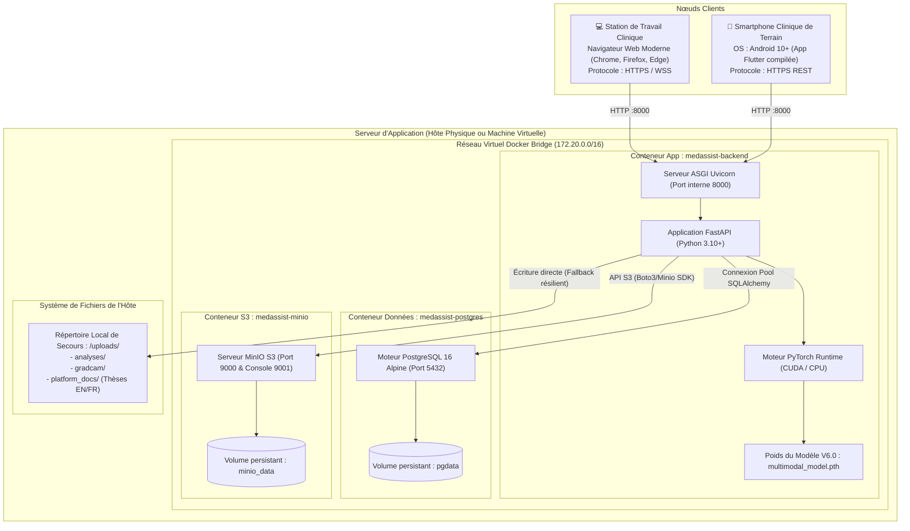

---

### 7.3 Matrice de Traçabilité Exigences-Conception

Cette matrice démontre la correspondance rigoureuse entre les exigences formulées dans le cahier des charges académique et les éléments de modélisation UML conçus.

| Code Exigence | Intitulé Fonctionnel / Non-Fonctionnel | Élément UML Modélisé | Composant / Classe d'Implémentation |
| :--- | :--- | :--- | :--- |
| **EX-F01** | Inférence multimodale assistée par vision artificielle | Diagramme de Séquence 2, Diagramme de Classes | `ModelService`, `predict.py` |
| **EX-F02** | Explicabilité visuelle par cartes thermiques d'attention | Diagramme de Séquence 2, Diagramme d'Activité | `GradCAMService`, `BackgroundTasks` |
| **EX-F03** | Gestion déterministe de l'incertitude (`INCONCLUSIVE`) | Diagramme d'États 3, Cas d'Utilisation CU-01 | `RiskEngine.assess_risk()` |
| **EX-F04** | Collaboration médicale et télé-expertise à distance | Diagramme de Séquence 3, Diagramme d'États 2 | `Referral`, `/api/v1/referrals` |
| **EX-F05** | Dossier patient pseudonymisé conforme RGPD | Modèle Logique (ERD), Diagramme de Classes | `Patient`, `patient_code` |
| **EX-F06** | Génération de compte-rendu imprimable avec QR éphémère | Diagramme des Cas d'Utilisation, Classes | `PDFReportService`, `ReportLab` |
| **EX-F07** | Intégrité et contrôle d'accès basé sur les rôles (RBAC) | Diagramme de Séquence 1, Diagramme d'États 1 | `User`, `RefreshToken`, `AuthGuard` |
| **EX-NF01** | Temps de réponse clinique global $< 500\text{ ms}$ | Diagramme de Séquence 2 (Threadpool & Async) | `run_in_threadpool`, `BackgroundTasks` |
| **EX-NF02** | Haute résilience sans interruption de service | Diagramme d'Activité (Sonde TCP) | `StorageService.is_minio_reachable()` |
| **EX-NF03** | Support linguistique complet (EN / FR / AR) | Diagramme des Composants | `DashboardI18n Engine` (`i18n.js`) |
| **EX-NF04** | Pérennité documentaire des mémoires officiels | Diagramme de Séquence 4 | `PlatformResourcesService` |

---

## Conclusion de la Spécification

L'ensemble des modèles UML formalisés dans ce document fournit une cartographie exhaustive, cohérente et rigoureuse de la plateforme **MedAssist AI V2**. 

Cette documentation satisfait aux exigences formelles d'un **Mémoire de Master en Génie Logiciel et Applications Avancées (GLAA)** en apportant :
1. Une modélisation fonctionnelle claire séparant les prérogatives des généralistes, des dermatologues et des administrateurs.
2. Une conception orientée objet modulaire découplée des détails d'infrastructure.
3. Une formalisation précise de la dynamique temporelle garantissant des temps de réponse compatibles avec la pratique médicale.
4. Une justification technique argumentée des choix architecturaux de sécurité et de résilience.

